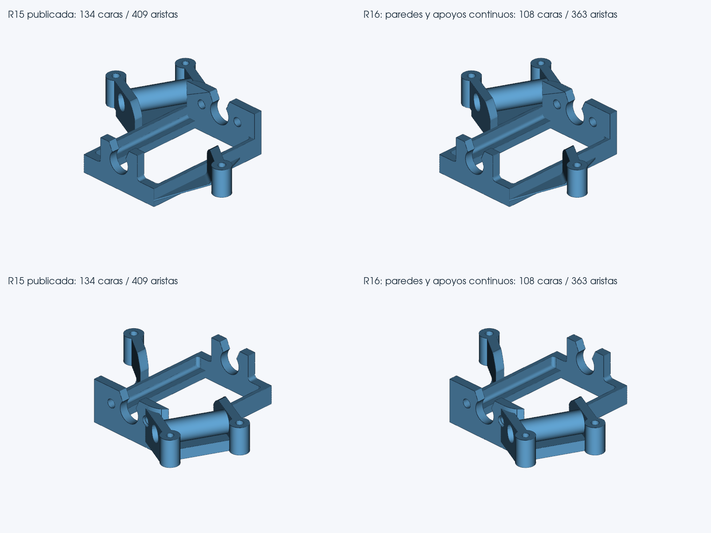

# Visor STL → STEP · R16 experimental

## Resultado de esta revisión

La bancada pasa de **134 a 108 caras**. Treinta parches de las dos paredes interiores y dos bandas de los apoyos en U se reconstruyen como **cuatro superficies continuas**. El contorno físico de esas regiones permanece compartido con las caras vecinas.

La nueva reconstrucción se ha ejecutado desde el STL original en la interfaz real del paquete completo, con importación, conversión y descarga del STEP. El archivo descargado coincide con el almacenado por el servidor y con su registro oficial de calidad.

Esta revisión resuelve la fragmentación principal de esas paredes y apoyos. Quedan seis grupos candidatos, con trece caras originales: tres tienen huecos o varios contornos, uno excede el presupuesto de frontera, otro no forma cuatro lados y otro produce un pliegue al unirlo. Sus caras se conservan y sus motivos figuran individualmente en la evidencia del trabajador. **No se declara la bancada al 100 % ni la importación en Onshape confirmada**: faltan la revisión visual del usuario en ese programa y la ejecución nativa en Windows.

## Medidas contra el STL original

| Comprobación | R15 | R16 |
|---|---:|---:|
| Caras STEP | 134 | 108 |
| Aristas STEP | 409 | 363 |
| Desviación máxima verificada, mm | 0.003438 | 0.003438 |
| Error de caja, mm | 0.000561 | 0.000561 |
| Error de volumen, % | 0.022032 | 0.019909 |
| Tolerancia nativa máxima de aristas, mm | 0.000000100 | 0.000000100 |
| B-Rep exacto | válido | válido |
| Interferencias CAD OpenCascade | 0 | 0 |

Los **25 recortes cilíndricos de R15 se conservan**, comprobando sus soportes y áreas comunes. No se han modificado radios, taladros ni agujeros para simplificar esta bancada.

Los perfiles originales permanecen sin cambios: Precisión, máximo 0,060 mm y caja 0,020 mm; Impresión, máximo 0,080 mm y caja 0,040 mm. Se conservan también los límites de volumen y las verificaciones de material y topología. La función `_calidad` mantiene su AST y los archivos de validación conservan sus huellas R15, recogidas en `Resultados_Pruebas/LIMITES_INMUTABLES_R16.json`.

El máximo medido de esta pieza sigue siendo 0,003438 mm; no ha sido necesario ampliar el presupuesto para conseguir la mejora. Los muestreos deterministas no se presentan como una cota Hausdorff matemática global. La altura de capa de una impresora tampoco equivale a su precisión dimensional XYZ; no se ha realizado impresión física en la K1C.

## Validación del STEP exportado

El STEP se escribe como un único sólido manifold, se reabre y pasa CAD exacto, auditoría de incidencia y orientación del archivo serializado, BOP y topología Euler **−14**.

| Deflexión, mm | Triángulos de la malla CAD | Euler | Intersecciones CGAL |
|---:|---:|---:|---:|
| 0.00025 | 423,774 | -14 | 0 |
| 0.00050 | 225,944 | -14 | 0 |
| 0.00100 | 133,808 | -14 | 0 |

Las tres mallas están cerradas y orientadas. Se han comprobado **2998 puntos de material del STL original, con cero discrepancias** y una banda excluida de 0,002 mm. Las distancias de las tres fronteras se vuelven a medir contra el STL original.

## Regresión real

Se han ejecutado **19 conversiones completas**, con 16 geometrías distintas: 13 archivos del corpus original, cubo-carrito con tres giros adicionales, Technic y una brida independiente. Las cuatro variantes del cubo-carrito se reparan/convierten y conservan el resultado R15.

**Fast+Funnel+large.stl queda aplazado por la indicación previa de no dedicar tiempo al embudo. La cobertura del corpus original es 13/14.** No se cuenta como prueba superada.

| Caso | Caras R15 → R16 | Máximo R16, mm | Tiempo observado | Comparación |
|---|---:|---:|---:|---|
| 1x1-lego-brick | 2672 → 2672 | 0.000000 | 2:13.6 | DATA idéntico |
| Bancada_Motor | 134 → 108 | 0.003438 | 18:53.6 | Mejora medida y certificada |
| Estefi | 1769 → 1769 | 0.000000 | 5:52.8 | DATA idéntico |
| Grapa | 20 → 20 | 0.001042 | 5:29.4 | DATA idéntico |
| LLanta_Trasera | 53 → 53 | 0.002138 | 1:33.3 | DATA idéntico |
| M3 PClip - 2mm | 1484 → 1484 | 0.000000 | 3:48.6 | DATA idéntico |
| Spoiler_arrière_Porsche_-_5 | 28 → 28 | 0.002827 | 0:08.9 | DATA idéntico |
| Technic_PEGS_Cross_x6_A | 845 → 845 | 0.001192 | 18:23.9 | DATA idéntico |
| Tirante | 22 → 22 | 0.027430 | 12:31.6 | DATA idéntico |
| brida_independiente | 10 → 10 | 0.000831 | 0:54.0 | DATA idéntico |
| chasis - Part 2 | 13803 → 13803 | 0.006785 | 12:38.2 | DATA idéntico |
| conector | 192 → 192 | 0.005906 | 5:28.7 | Redondeo numérico auditado |
| cubo-carrito | 1152 → 1152 | 0.000000 | 1:40.4 | DATA idéntico |
| cubo-carrito_giro_1 | 1838 → 1838 | 0.000000 | 1:51.9 | DATA idéntico |
| cubo-carrito_giro_2 | 1195 → 1195 | 0.000000 | 1:31.5 | DATA idéntico |
| cubo-carrito_giro_3 | 1853 → 1853 | 0.000000 | 1:48.8 | DATA idéntico |
| maneta | 36 → 36 | 0.016033 | 6:51.7 | DATA idéntico |
| pinza | 147 → 147 | 0.003787 | 4:45.0 | DATA idéntico |
| spur | 1405 → 1405 | 0.004738 | 2:47.6 | DATA idéntico |

Los controles adicionales se ejecutaron con dos conversiones simultáneas como máximo. La bancada se midió por interfaz, mientras que la referencia R15 procede de CLI; estos tiempos describen las ejecuciones observadas y no constituyen una comparación controlada de rendimiento. La conversión de bancada en interfaz tardó **18:53.6**; el trabajador nuevo y sus controles tardaron **3:06.3**. Esta revisión mejora calidad; el tiempo de conversión sigue siendo un trabajo pendiente.

En el conector se detectaron dos diferencias de redondeo en coordenadas próximas a cero: **1,341519488088 × 10⁻¹⁶ mm**. Las 63.061 unidades léxicas, las referencias y la estructura de entidades se han auditado; el resto de los valores permanece igual y sus métricas de geometría no empeoran. El controlador inicial exigía identidad literal y por ello no contó ese caso como equivalente; el consolidado añade esta auditoría explícita. Se incluyen ambos registros. Se conserva la distinción entre DATA literalmente idéntico y equivalencia numérica; no se alteró ninguna puerta de aceptación del programa.

## Otros controles del nuevo método

- **impresion / STL original**: aprobado; tiempo 7:12.1. 108 caras; máximo 0.003438 mm.
- **precision / bancada rotada y renombrada**: no aprobado: Límite de tiempo: 420 s; plazo 420 s, máximo 420 s. No se ha obtenido un STEP aprobado; no es una medición de error dimensional.; tiempo 7:45.1.

La variante girada detectó cruces en el primer candidato y reintentó retirando regiones. El segundo intento alcanzó el control fino, pero el trabajador agotó el límite de 420 segundos sin un candidato aprobado. Se verificó después que el STEP base conserva exactamente su SHA-256. Este ensayo **no demuestra mejora de la pieza girada** y no se cuenta entre las 19 conversiones aprobadas. No se amplió el plazo para convertirlo en un éxito.

Estos ensayos del postproceso parten de una referencia CAD previamente aprobada y vuelven a verificar el STL correspondiente. Se distinguen de las conversiones completas anteriores.

## Cambios en el motor

- Detección de grupos por adyacencia, normales y direcciones de extrusión; sin nombres de pieza ni plantillas de coordenadas.
- Reconstrucción con curvas de perímetro compartidas y testigos bidireccionales.
- Ajuste de polos exclusivamente en la normal dominante: conserva la proyección de la carta y evita los pliegues introducidos por ajustes libres en XYZ.
- Comprobación de orientación antes y después, y controles finales independientes de la propuesta.
- Respaldo inmutable del STEP R15 y sustitución sólo después de aprobar el candidato; una cancelación no se convierte en éxito mediante un respaldo.
- Trabajador autónomo respecto al directorio de lanzamiento, identidad R16, puerto 8780 y evidencia oficial disponible en el diagnóstico.

El alcance de activación es conservador: sólidos ya aprobados con mezcla de planos, cilindros, extrusiones y parches B-spline, de tamaño acotado, y STL sano. Las conversiones compactas o reparadas conservan la ruta anterior. El STEP representa superficies y sólidos CAD, sin prometer un árbol de operaciones paramétricas.

## Referencia Easy recibida

`Bancada_Motor_IA.step` tiene 89 caras y un aspecto más compacto. En este archivo concreto se observaron 14 caras que no pasan CAD exacto y tres interferencias BOP; la desviación diagnóstica máxima fue aproximadamente 0,05942 mm y la tolerancia de arista máxima 0,06269 mm. Sirvió para localizar regiones y comparar superficies, no como plantilla incrustada en el conversor ni como archivo aprobado para la entrega.

## Pruebas automatizadas y omisiones

**382 pruebas aprobadas y 15 omitidas**, sin fallos en la ejecución final de la batería completa. Se incluyen sus resultados y motivos individuales. Son contrapruebas heredadas cuyos fixtures externos no estaban parametrizados en esta batería:

- `test_correcciones_r2.test_reparacion_real_r2_contrasta_original[Fallo_Dimensional.stl]`: STL aportados no indicados
- `test_correcciones_r2.test_reparacion_real_r2_contrasta_original[Pieza ambigua.stl]`: STL aportados no indicados
- `test_correcciones_r2.test_muestreo_no_corrompe_juicio_del_brep`: STEP de regresión de caché no indicado
- `test_correcciones_r2.test_no_acepta_cad_solo_por_ser_valido_sin_interferencias`: STEP de regresión densa no indicado
- `test_mejoras_r3.test_rescate_exige_repetir_control_avanzado`: STEP defectuoso aportado no indicado
- `test_mejoras_r4.test_bandas_reales_tienen_evidencia_y_cobertura_sin_editar_vertices`: RAR de pruebas no indicado
- `test_mejoras_r4.test_vertices_reales_se_diagnostican_antes_de_reconstruir[6558_fixed.stl-33]`: RAR de pruebas no indicado
- `test_mejoras_r4.test_vertices_reales_se_diagnostican_antes_de_reconstruir[Dimensiones tambien.stl-14]`: RAR de pruebas no indicado
- `test_mejoras_r4.test_vertices_reales_se_diagnostican_antes_de_reconstruir[Pieza_Nueva_Detenida.stl-54]`: RAR de pruebas no indicado
- `test_preprocesador.test_cubo_carrito_y_referencia_real`: STL privados no indicados
- `test_preprocesador.test_cubo_carrito_reparacion_rotada[angles0]`: STL privados no indicados
- `test_preprocesador.test_cubo_carrito_reparacion_rotada[angles1]`: STL privados no indicados
- `test_preprocesador.test_cubo_carrito_reparacion_rotada[angles2]`: STL privados no indicados
- `test_preprocesador.test_14_historicos_no_se_reescriben`: STL privados no indicados
- `test_saneamiento_verificado.test_autointerseccion_real_se_rechaza_en_frio_antes_del_mallado`: Fixture CAD externo no disponible

Un ensayo de arranque del trabajador excedió 45 segundos mientras corría otra conversión CAD; pasó aislado y en la batería final sin carga simultánea. No se amplió su plazo para ocultarlo. Durante el desarrollo también se descartó una propuesta de 120 caras que pasaba CAD exacto pero presentaba pliegues e intersecciones en el mallado fino; esa propuesta no forma parte del programa entregado.

El primer verificador de navegador buscó un campo resumen que la API no promueve. La misma descarga de 108 caras se comprobó después contra `/reparacion/1c23010ae1a0/r16_nucleo`, verificando identidad de código, perfil, STL, STEP y registro completo. Se conserva la incidencia en los resultados; el modelo descargado no fue sustituido para completar esa comprobación.

## Comprobaciones pendientes

- Windows nativo: no disponible en el entorno de trabajo; se han probado el código y flujo completo de interfaz en Linux, incluido un directorio con espacios.
- Importación y aspecto final en Onshape: requiere la prueba del usuario; no se afirma compatibilidad confirmada desde OpenCascade.
- Impresión física y ajuste mecánico en la K1C: no realizados.
- Embudo original: aplazado según lo indicado.

La copia experimental conserva la interfaz y la versión R15. Para probarla, descomprimir el ZIP completo en una carpeta nueva y abrir `Iniciar_R16.bat`. El encabezado debe mostrar **R16 experimental**. Se incluyen el STL de la bancada y el STEP descargado en `Prueba_Bancada`.

STL bancada SHA-256: `1b0dac5808f07b68a1ec91b8baa83d11a56c20dd0d83611c02e0a0bc12b2a0c1`. STEP R16 SHA-256: `d53b92c85dcb755ec42f5244f9f6485310604c1d37e898ebfc15f5cbb35e685b`.
