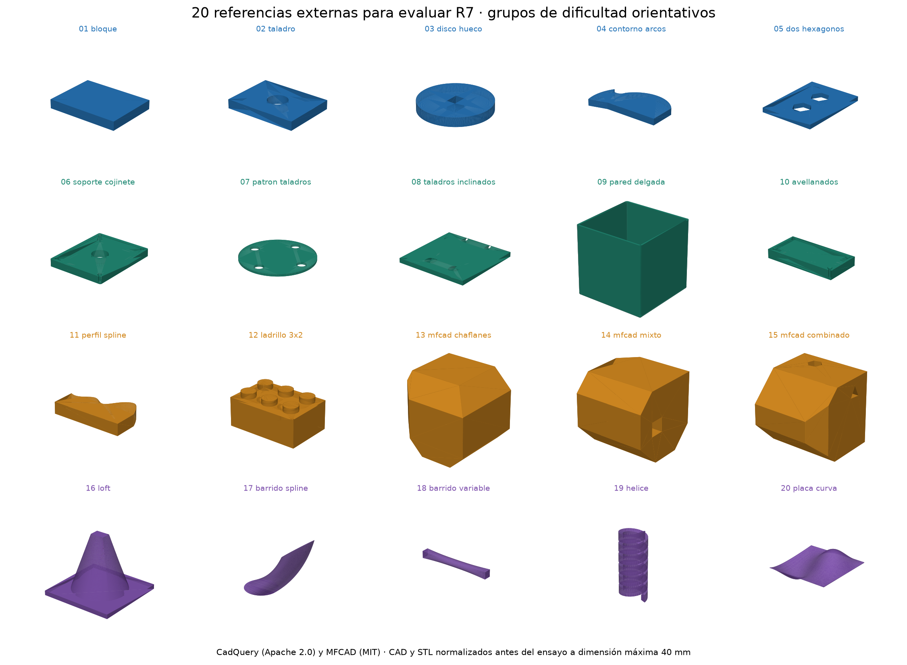
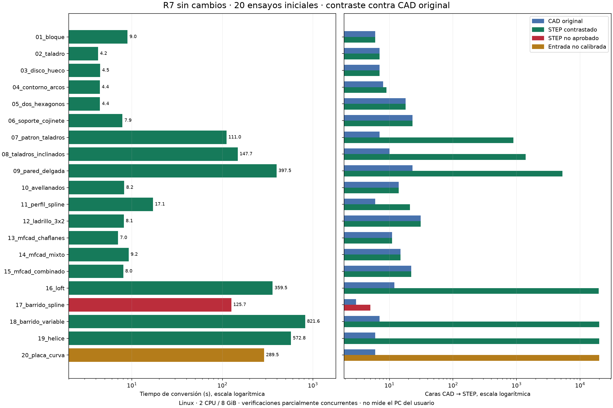
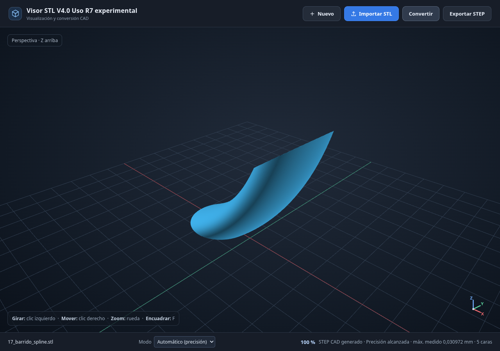

# Capacidad del Visor R7: batería externa del 26/10/2026

**De los veinte ensayos iniciales, R7 acepta todos; el contraste CAD aprueba 18, detecta 1 salida defectuosa y excluye 1 por discretización de entrada insuficiente.** La aceptación de la interfaz no demuestra por sí sola que el STEP sea correcto.

La placa del ensayo excluido se ha vuelto a mallar más finamente, sin modificar su CAD ni el motor ni ampliar tolerancias. Su repetición supera el contraste completo. Así, se han verificado 19 de las 20 geometrías distintas con R7 predeterminada, incluyendo esa repetición por separado. **La malla fina contiene 44 pares de triángulos con intersección CGAL: no se cuenta como otro caso de entrada sana.** Los dos intentos de la placa quedan registrados.

**Fallo reproducido: `17_barrido_spline`.** Un STL sano produce un STEP con autointersección CAD. R7 lo ofrece como «Precisión alcanzada». El fallo se ha confirmado tanto con el motor completo como mediante conversión y descarga desde la interfaz. El STEP defectuoso queda en `NO_APROBADOS/`, para reproducir el problema. No debe usarse como conversión aprobada.

Esta entrega es un kit de evaluación de R7, **no una actualización del Visor**. No se ha cambiado ningún archivo del motor: los 96 archivos del inventario publicado coinciden por SHA-256. No se ha desarrollado ni denominado una R8. La web WebAssembly de `main` queda fuera de este ensayo.

## Piezas y procedencia

Se congelaron veinte geometrías antes de observar resultados: diecisiete ejemplos públicos de [CadQuery](https://github.com/CadQuery/cadquery/tree/8178185a24a035c9af7f4679033be14267f6a6ef/examples), Apache-2.0, y tres modelos STEP de [MFCAD](https://github.com/hducg/MFCAD/tree/ef6d58a40164d5192666821ce98d0cc90e379fac/dataset/step), MIT. Cada caso conserva URL, commit, fuente original y SHA-256 en `corpus.json`. Las fuentes seleccionadas y licencias completas se incluyen. No son piezas aportadas por el usuario.

Los STL se han generado aquí a partir de esos CAD públicos; no se presentan como STL descargados ni como escaneos reales. Antes de convertir, se aplica al CAD una escala uniforme hasta 40 mm de dimensión máxima y un centrado. Se generan de la misma geometría el STEP de referencia y el STL binario. La malla usa deflexión absoluta solicitada de 0,003 mm y ángulo de 0,08 rad. No se escala el resultado para hacerlo pasar.

Las veinte referencias contienen un sólido válido sin interferencias OCC. Los veinte STL iniciales son cerrados, orientados, sin vértices no manifold ni intersecciones CGAL y conservan Euler. La calibración geométrica adicional exige desviación máxima muestreada ≤ 0,005 mm: pasan diecinueve entradas y la placa 20 llega a 0,005377 mm, por lo que se excluye ese intento. Un mallado más fino de la misma placa reduce su máximo medido a 0,003195 mm antes de convertirla. Hay de 12 a 53.862 triángulos en los veinte originales y 97.208 en la repetición fina; de 3 a 31 caras CAD originales. El ladrillo es un 3×2 hueco; MFCAD aporta mecanizado poliédrico, no tres modelos industriales curvos.

Los cuatro grupos, de cinco piezas cada uno, ordenan familias de dificultad orientativa. No forman una escala universal: una pieza de mecanizado plana puede resultar más sencilla que una caja de pared fina del grupo anterior.

## Resultado de cada conversión

Todos los tiempos son del motor completo y están en segundos. «CAD» es el contraste adicional, no la declaración de éxito del Visor. «S» identifica la ruta `superficies`; «F», `recuperacion_facetada`. La ruta S también puede conservar parches planos y no implica un historial paramétrico. «Caras» compara CAD original → STEP exportado. La tabla conserva los veinte intentos iniciales; la repetición de 20 se documenta a continuación.

| ID y pieza | Grupo | Triángulos | Caras | Ruta | Tiempo s | CAD |
|---|---:|---:|---:|:---:|---:|:---:|
| 01_bloque — Bloque rectangular | 1 | 12 | 6 → 6 | F | 9.0 | APROBADO |
| 02_taladro — Bloque con taladro central | 1 | 648 | 7 → 7 | S | 4.2 | APROBADO |
| 03_disco_hueco — Disco con abertura rectangular | 1 | 1044 | 7 → 7 | S | 4.5 | APROBADO |
| 04_contorno_arcos — Extrusión de líneas y arcos | 1 | 716 | 8 → 9 | S | 4.4 | APROBADO |
| 05_dos_hexagonos — Placa con dos huecos hexagonales | 1 | 68 | 18 → 18 | S | 4.4 | APROBADO |
| 06_soporte_cojinete — Soporte con taladro, cajeados y redondeos | 2 | 6360 | 23 → 23 | S | 7.9 | APROBADO |
| 07_patron_taladros — Disco con cuatro taladros | 2 | 3568 | 7 → 891 | F | 111.0 | APROBADO |
| 08_taladros_inclinados — Placa con taladros inclinados | 2 | 3252 | 10 → 1400 | F | 147.7 | APROBADO |
| 09_pared_delgada — Caja abierta con pared fina | 2 | 5804 | 23 → 5307 | F | 397.5 | APROBADO |
| 10_avellanados — Placa con cuatro avellanados | 2 | 6980 | 14 → 14 | S | 8.2 | APROBADO |
| 11_perfil_spline — Perfil spline extruido | 3 | 5838 | 6 → 21 | S | 17.1 | APROBADO |
| 12_ladrillo_3x2 — Ladrillo hueco 3x2 con tubos interiores | 3 | 6348 | 31 → 31 | S | 8.1 | APROBADO |
| 13_mfcad_chaflanes — Modelo de mecanizado MFCAD, serie 0 | 3 | 32 | 11 → 11 | S | 7.0 | APROBADO |
| 14_mfcad_mixto — Modelo de mecanizado MFCAD, serie 10 | 3 | 44 | 15 → 15 | S | 9.2 | APROBADO |
| 15_mfcad_combinado — Modelo de mecanizado MFCAD, serie 1/3 | 3 | 96 | 22 → 22 | S | 8.0 | APROBADO |
| 16_loft — Transición de círculo a rectángulo | 4 | 49836 | 12 → 19766 | F | 359.5 | APROBADO |
| 17_barrido_spline — Sección circular sobre recorrido spline | 4 | 40850 | 3 → 5 | S | 125.7 | NO_APROBADO |
| 18_barrido_variable — Barrido con varias secciones rectangulares y circulares | 4 | 31694 | 7 → 19992 | F | 821.6 | APROBADO |
| 19_helice — Perfil cerrado barrido en hélice | 4 | 53862 | 6 → 19998 | F | 572.8 | APROBADO |
| 20_placa_curva — Placa fina de doble curvatura | 4 | 38920 | 6 → 20000 | F | 289.5 | ENTRADA_NO_CALIBRADA |

Rutas observadas: {'recuperacion_facetada': 8, 'superficies': 12}. Los detalles de tipos de superficie, RAM, tolerancias internas B-rep, errores, muestras y fuentes están en `resultados_sanos.csv` y en los JSON de evidencia.

**Repetición `C20_remallado_fino`:** 225.1 s de conversión; CAD APROBADO; 20011 caras de salida; p95 bidireccional 0.002277 mm; máximo muestreado 0.004371 mm. La deflexión solicitada baja a 0,00025 mm y el ángulo a 0,02 rad. No cambia ninguna tolerancia de aceptación. El protocolo complementario se fijó antes de ejecutar esta repetición y conserva su motivo. La verificación posterior de esa misma malla detectó 44 pares CGAL; la regeneración obtiene exactamente su SHA-256. Se conserva como variante problemática con CAD esperado conocido y salida comprobada, sin sumarla a las dieciocho entradas sanas aprobadas.

Se comprobó también la teselación de las caras planas del STEP fino, conservando doble precisión: 20.036 triángulos, malla cerrada y orientada, **0 pares CGAL**, frente a 44 en la entrada. La salida conserva además Euler, material y geometría dentro de los límites del contraste. `complementario_20/control_cgal_salida.json` registra su huella y el método; es una evidencia adicional de recuperación de esta variante concreta.

Los modelos sencillos con cilindros y avellanados permiten recuperar superficies compactas: por ejemplo, el soporte conserva 23 caras y el ladrillo 31. Sin embargo, el patrón de taladros pasa de 7 a 891 caras, la pared fina de 23 a 5.307, y el loft de 12 a 19.766. Estos STEP pueden superar las comprobaciones geométricas y seguir siendo incómodos para editar. Una salida con miles de planos no equivale a recuperar sus curvas originales.

El barrido variable tarda unos 13,7 minutos y es el caso más lento. La pared fina tarda 397,5 s con 5.804 triángulos, mientras que el soporte tarda 7,9 s con 6.360. El tipo de geometría y la ruta de reconstrucción pesan más que el recuento de triángulos por sí solo. Estos resultados no permiten atribuir los límites de tiempo al ordenador del usuario.

## El falso positivo del barrido spline

La referencia tiene 3 caras y la salida 5. El error de volumen es 0.063998 %, el de caja 0.017213 mm y la desviación máxima del contraste 0.024655 mm. El p95 adicional CAD→resultado es 0,021425 mm, por encima de 0,020 mm. Este p95 usa puntos de caras y aristas, distintos del muestreo del motor; no se confunden ambas distribuciones.

Además de esa diferencia de muestreo, `BRepAlgoAPI_Check` informa `BOPAlgo_SelfIntersect` al reimportar el STEP en un proceso frío, antes de teselar. `isValid()` devuelve True y hay un sólido: esas dos condiciones no bastan para descartar autointersecciones. La referencia fría no tiene esa incidencia.

La prueba de navegador usa Chromium sobre Linux, perfil Precisión, carga STL, conversión, aprobación al 100 % y descarga. El bloque DATA descargado es idéntico al del ensayo del motor, y vuelve a dar autointersección al leerlo. `repro_navegador/flujo.json`, `contraste_descarga.json` y `confirmacion_barrido_spline.json` documentan la comprobación.

La captura muestra la previsualización del STL y la aprobación de la conversión; no es una inspección visual del STEP. La lectura fría es la evidencia del defecto CAD. La cobertura del control de interferencias en todas las rutas de reconstrucción merece prioridad en el siguiente bloque de desarrollo.

## Defectos y estabilidad: diez pruebas adicionales

Son variantes de los modelos anteriores, no diez geometrías externas nuevas. Se declararon antes de ejecutarlas en `protocolo_secundarios.json`.

| Variante | Resultado real | Tiempo s |
|---|---|---:|
| D01_caras_duplicadas | RECHAZADO | 2.7 |
| D02_orientacion_parcial | RECHAZADO | 2.2 |
| D03_ruido_micrometrico | REPARADO_Y_VERIFICADO | 6.9 |
| D04_hueco_grande | RECHAZADO | 1.6 |
| D05_isla_pequena_separada | RECHAZADO | 1.6 |
| D06_solidos_solapados | REPARADO_Y_VERIFICADO | 17.0 |
| R_02_taladro | CONVERTIDO_Y_VERIFICADO | 4.7 |
| R_09_pared_delgada | CONVERTIDO_Y_VERIFICADO | 338.5 |
| R_16_loft | CONVERTIDO_Y_VERIFICADO | 427.7 |
| G17_control_interferencias | CONVERTIDO_Y_VERIFICADO | 750.0 |

Se demuestran dos reparaciones: ruido micrométrico (σ=0,00015 mm, perturbaciones menores de 0,001 mm) y dos sólidos solapados cuya referencia esperada se fijó expresamente como su unión CAD. Ambas salidas pasan el contraste contra la geometría original prescrita. Esto no permite generalizar a cualquier solapamiento ambiguo.

R7 rechaza caras duplicadas y tres caras con orientación invertida: son dos capacidades de reparación aún pendientes. También rechaza un hueco grande y un pequeño cuerpo separado de 0,2 mm: evita inventar el cierre o eliminar ese cuerpo. No se contabilizan los cuatro rechazos como reparaciones.

Las tres rotaciones rígidas (0,43 rad sobre el eje 1,2,3, aplicadas al CAD y al STL) conservan la geometría. El número de caras y los tiempos pueden cambiar con la pose; no se demuestra invariancia del coste ni de la segmentación.

La variante `G17_control_interferencias` activa exclusivamente la bandera ya existente `VISOR_VERIFICAR_INTERFERENCIAS_CAD=1`: **CONVERTIDO_Y_VERIFICADO**, 750.0 s. Incidencia: ninguna registrada. Es un diagnóstico con configuración distinta; no modifica el resultado de la R7 predeterminada ni se presenta como una corrección terminada.

## Qué comprueba el evaluador

El evaluador no invoca `_calidad` ni acepta sus métricas como prueba. Reabre el CAD original y el STEP exportado y calcula distancias con proyecciones BRepExtrema, en ambos sentidos. Muestrea vértices, posiciones de aristas y puntos UV interiores de caras, con semillas fijas y límites de muestras. Comprueba también volumen, caja, Euler, envolventes, interferencias OCC y clasificación interior/exterior de puntos de material.

| Criterio de salida | Umbral |
|---|---:|
| Error de volumen | ≤ 0,5 % |
| Coordenadas extremas estimadas de la caja | ≤ 0,020 mm |
| p95 de distancias, en ambos sentidos | ≤ 0,020 mm |
| Máximo observado en las muestras | ≤ 0,060 mm |
| Sólidos válidos | 1 |
| Euler y envolventes | iguales al original |
| Interferencias OCC | 0 |
| Clasificación de material | 0 discrepancias fuera de banda de 0,08 mm |

En la placa offset se detectó que la caja fría OCC sobreestima un extremo en unos 2,39 mm; ese dato no se interpreta como pérdida física de 2,39 mm. Para todos los casos se recalculó sólo la caja con extremos de un mallado CAD absoluto de 0,00025 mm y 0,04 rad, conservando el resto de mediciones y los registros previos. En la placa, reducir la deflexión de 0,0005 a 0,00025 mm cambia los extremos menos de 0,000208 mm. La caja pasa a ser una estimación geométrica uniforme, no una cota analítica global; su límite sigue siendo 0,020 mm. `revision_cajas_todos.json` documenta cada cambio, incluidos los aprobados.

La banda de 0,08 mm sólo excluye puntos cercanos a la superficie en la prueba de material. **No es una tolerancia de conversión ni un perfil de impresión**: las distancias siguen limitadas por 0,020/0,060 mm. La tolerancia interna de una arista B-rep tampoco equivale a un error geométrico medido; se conserva como dato separado en el CSV.

En los seis STL dañados deliberadamente se excluye sólo la calibración geométrica de la entrada frente al CAD sano. Todas las condiciones de salida permanecen intactas. Los límites de este evaluador no se ampliaron para aprobar casos. Tampoco se cambió el perfil Precisión del Visor.

Los controles del propio evaluador pasan: identidad aprobada, desplazamiento de 0,1 mm rechazado y microtaladro rellenado rechazado por topología aunque la diferencia de volumen sea menor del 0,5 %. Se corrigió al principio una serialización JSON de booleanos NumPy; esos intentos se archivaron y repitieron, sin contarlos como fallos del motor.

Se aceleró el evaluador conservando la forma CAD objetivo entre proyecciones. Se mantuvieron los mismos puntos y umbrales; 54 mediciones comparadas en tres modelos, incluido un STEP facetado grande, no muestran ninguna diferencia numérica. El hash final del evaluador y la verificación de equivalencia constan en el protocolo.

Al probar la reproducción desde el ZIP extraído se detectó otro problema del evaluador: mallar finamente el STEP defectuoso 17 antes de comprobar interferencias superó su límite de 3.000 MiB. La versión 4 entregada adelanta esa misma comprobación CAD a la lectura fría y rechaza el STEP antes de mallarlo. No se cuenta el agotamiento de memoria como rechazo geométrico ni se amplía el presupuesto. Los datos completos previos y el evaluador de versión 3 se conservan para auditoría; el orden nuevo no cambia ninguna condición de aceptación.

## Tiempo, recursos y límites de esta conclusión

Entorno: Linux, Python 3.12.14, CadQuery 2.8.0 y OpenCascade 7.9.3.1.1, cuota de 2 CPU y 8 GiB de RAM. BLAS/OMP limitados a un hilo. Un motor a la vez; parte de los contrastes CAD se ejecutó simultáneamente, compartiendo CPU. La RAM pico del motor principal va de aproximadamente 0,56 a 2,04 GiB. Los tiempos son de pared observados, no mediciones del ordenador del usuario ni de Windows.

El motor dispone de 4.096 MiB por proceso y presupuestos de 300/480/720/900 s según el grupo. Las veinte conversiones principales terminan dentro de ellos. Los procesos de contraste completos disponen de 3.000 MiB: inicialmente 240 s; se amplió a 600 s para 16,18,19,20 y después a 1.200 s para 20, conservando los intentos anteriores. La revisión posterior de sólo cajas se ejecutó como análisis aparte, bajo el límite global de 8 GiB, sin registrar su pico individual. Son límites del **contraste**, distintos del tiempo de conversión; un contraste interrumpido se etiqueta SIN_VERIFICAR.

Son geometrías seleccionadas y limpias, normalizadas a 40 mm, con pocos defectos sintéticos. El generador CAD y el lector de resultados comparten OpenCascade, aunque el evaluador es código separado del motor. No representan escaneos, grandes corpus industriales, ruido real ni todos los STL arbitrarios. Las distancias y el material se muestrean; no se demuestra una cota Hausdorff global ni la ausencia matemática de toda pérdida local.

No se ha probado Windows nativo, la web WebAssembly, importación en otros CAD ni impresión en la Creality K1C. Tampoco se han repetido en este ensayo las piezas históricas del usuario: el código R7 está intacto y esta batería aporta casos nuevos, sin reemplazar las pruebas anteriores.

## Uso del kit y siguiente paso

Para probar en el Visor que ya tienes, extrae el ZIP y abre los STL de `stl_sanos/`, empezando por 01–05. No copies archivos del kit sobre tu instalación. `referencias/` contiene el CAD esperado; `STEP_APROBADOS/` sólo salidas que superan este contraste, `NO_APROBADOS/` conserva el fallo, y `SIN_VERIFICAR/` se usa para cualquier salida inconclusa.

`LEEME.md` explica la reproducción por caso y la comprobación de integridad. `resultados_sanos.csv` y `resultados_secundarios.csv` se pueden abrir en una hoja de cálculo. Las evidencias conservan informes, registros, fuentes, semillas y presupuestos, incluidos los intentos incompletos del evaluador.

El siguiente desarrollo debe comenzar por impedir que una salida con interferencias CAD reciba aprobación, cubrir esa comprobación en todas las rutas y verificar una alternativa segura. Después conviene reducir los miles de parches de las familias que aquí recurren a facetas y mejorar duplicados/orientación. Cualquier cambio deberá repetir esta batería y las regresiones históricas. Esta evaluación deja un caso sano que reproduce el falso positivo y una referencia CAD con la que demostrar la corrección.
