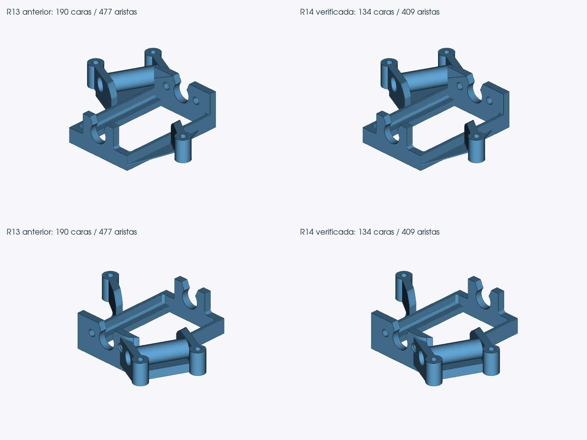

# R14 experimental: avances comprobados y versión completa para pruebas

Se implementan las dos vías solicitadas: reconstrucción de regiones conectadas con fronteras protegidas y operaciones CAD para paredes cilíndricas medidas en el STL. La mejora regional está demostrada. **No doy por cerrada la integración completa de los cilindros del conector:** las pruebas automáticas agotaron su tiempo durante el control de material. El programa conservó el STEP anterior validado.

## Resultados reales del programa

| Pieza | Caras R13 → R14 | Cilindros conservados | Máximo observado, mm |
|---|---:|---:|---:|
| Bancada Motor | 190 → 134 | 25 | 0.003438 |
| Pinza | 448 → 147 | 11 | 0.003787 |
| Conector, flujo automático ensayado | 19.998 → 19.998 | 0 | 0,010826 |

Bancada conserva además sus 14 caras de extrusión. Su caja y máximo no empeoran y el error de volumen mejora de 0,024630 % a 0.022032 %. Pinza conserva máximo y caja y mejora el error de volumen de 0,036855 % a 0.036123 %. No hay condiciones basadas en los nombres de las piezas.

18 casos completos terminan con STEP aprobado: 13 históricos, cubo-carrito y sus tres rotaciones, y Technic. 16 conservan exactamente el bloque DATA de R13. Bancada y pinza se sustituyen tras CAD exacto, BOP en frío, inspección densa contra el original, material, topología y tres mallados finos sin cruces. Maneta conserva 36 caras; llanta 53; tirante 22. El cubo mantiene su reparación y su geometría R13. **Embudo sigue aplazado: no se declara 14/14 originales.**

Technic conserva exactamente sus 845 caras R13: se rechaza su propuesta nueva por empeorar la desviación máxima. Los resultados por pieza, hashes y registros están en los JSON/CSV y en `Resultados_pruebas`.

## Conector: candidato y límite de la prueba

El motor construye dos paredes cilíndricas mediante operaciones CAD y produce un candidato de 18.623 caras (18.621 planas y 2 cilíndricas). El archivo se identifica por SHA-256 `f45a2e7ccf7283b55b7c75b9e4a9266a24e6efde467d77973093beafd02c6977`. Su CAD exacto, BOP, topología y tres mallados finos se verificaron contra el STL original. Máximo denso observado: 0.009861 mm, frente a 0,010826 mm en R13; caja 0.000000 mm; error de volumen 0.002912 %.

La comprobación independiente de material del mismo archivo tiene resultado **True**: 2999 puntos; 0 discrepancias. Se mantienen los 3.000 puntos iniciales, la exclusión de 0,002 mm junto a la fuente y el clasificador CAD nativo; no se reducen controles para conseguir aprobación. Detalle en `CONECTOR_CANDIDATO_INDEPENDIENTE.json`.

Esto distingue la validez del candidato de su aplicación automática. Los presupuestos opcionales ensayados de 900, 1.200 y 1.800 s se agotaron; el último llegó a 2.900 de 2.999 puntos de material y devolvió R13. **La nueva configuración de 2.100 s para operaciones y hasta 60 minutos totales en STL de más de 100.000 triángulos queda pendiente de una prueba fría completa.** No se declara aprobado ese flujo ni se cambia su resultado de referencia por el candidato. Las regiones mantienen su presupuesto de 420 s.

## Cambios en el motor y seguridad geométrica

- Segmentación por continuidad, protección de superficies analíticas y contornos, reconstrucción nativa de grupos compatibles y retirada local si CGAL detecta cruces.
- Medición de anillos completos, normales y todos los interiores triangulares; cotas radiales históricas de 0,008 mm. Reconstrucción mediante unión/corte CAD, sin redondear a dimensiones nominales y conservando el volumen anterior.
- Índices OCCT con la misma identidad IsSame sustituyen búsquedas cuadráticas de caras y aristas; se comprueban identidad, localización y tolerancias. No se afirma una aceleración global.
- Procesos aislados, SHA-256 de entradas y salidas, copias validadas por etapa y recuperación del resultado anterior ante rechazo o agotamiento. No se presenta un STEP facetado como reconstrucción paramétrica completa.

No se ampliaron los límites geométricos R13. `_calidad` tiene el mismo AST y los archivos de perfiles y controles comparados son idénticos (`NO_RELAJACION_LIMITES.json`). Caja base: 0,02 mm; volumen: 0,5 %; máximo superficial: 0,06 mm; p95 calculado original. La mejora exige además no empeorar máximo observado, caja ni error de volumen anterior, con margen numérico de 0,000001. Las nuevas aristas llevan cotas numéricas asignadas por OCCT; no se rebajan etiquetas para ocultar incompatibilidades. Un ensayo que forzaba esas etiquetas se descartó al fallar CAD exacto.

## Pruebas y límites

- Visor: 338 pruebas, 0 fallos, 0 errores, 0 omitidas.
- Nucleo: 392 pruebas, 0 fallos, 0 errores, 0 omitidas.
- Paquete: 104 pruebas, 0 fallos, 0 errores, 0 omitidas.

Visor y núcleo comparten algunas pruebas; no son conjuntos disjuntos. El Visor se probó inicialmente antes de los ajustes finales de tiempo; la batería del paquete corresponde a las fuentes entregadas. La ejecución preliminar del núcleo se interrumpió para repetirlo con las fuentes definitivas. Se corrigió una ruta del lanzador de pruebas tras un error de colección; no era un fallo de conversión.

Chromium real cargó STL, convirtió y descargó caja y bancada desde una carpeta con espacios: encabezado R14, perfil Precisión, instancia correcta, cero errores JavaScript y descarga idéntica al STEP validado. La bancada descargada tiene 134 caras y sus 25 cilindros. La lectura fría confirma un sólido CAD exacto. Después se ajustó sólo el presupuesto de las operaciones en mallas grandes, sin afectar a esa ruta de la bancada; las pruebas del paquete se repitieron con la configuración final. Los informes distinguen esa ejecución de una nueva conversión fría del conector, que falta.

La conversión sigue siendo lenta. La última prueba automática del conector duró unos 49 minutos y conservó R13. Los tiempos son Linux, cuota de dos CPU y regresión concurrente; no son un benchmark de Windows. Las mediciones geométricas y de material son reproducibles y muestreadas, no una prueba Hausdorff global.

Windows nativo, Onshape e impresión K1C no se han probado aquí. MediumBig necesita su STL original para certificar geometría. El conector conserva muchas facetas incluso en el candidato cilíndrico. No se ha validado conversión WebAssembly: esta entrega es el Visor completo con backend local Python.

## Probar esta versión

Extraer TODO `perfeccion_Visualizador_R14_EXPERIMENTAL_COMPLETA.zip` en una carpeta nueva y abrir `Iniciar.bat`. Incluye `Visor_experimental_fuentes`; Python 3.12 x64 y reutilización de entorno compatible R7–R13. Mantener Automático (precisión). Encabezado R14, puerto 8778. Conservar la versión anterior.

Probar primero bancada y pinza, y comparar después maneta, llanta y cubo. En conector observar `reconstruccion_regional.aplicado` y los diagnósticos de `Registros_Conversion`: si agota el presupuesto o rechaza la propuesta, conserva su STEP anterior. La comparación del conector incluye, cuando supera material, un candidato identificado como validación independiente; no se presenta como resultado automático aprobado.

No es una prueba de importación en Onshape.
