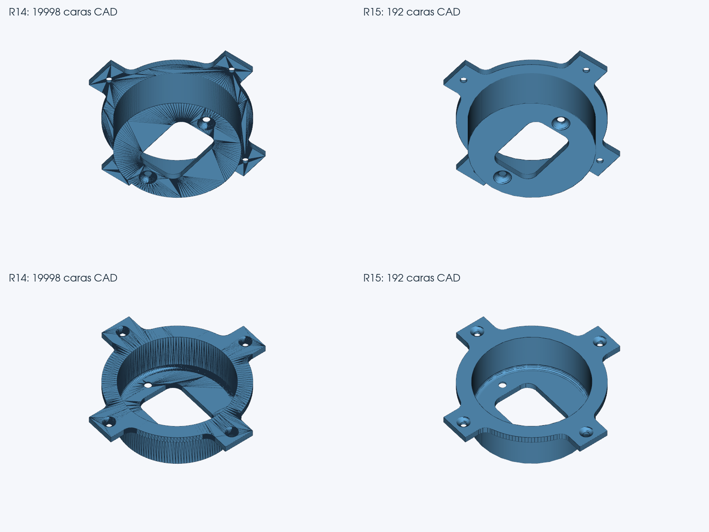

# Visor STL → STEP — R15 experimental

Fecha de cierre: 2026-11-03T14:26:56.717507+00:00. Copia experimental completa para Windows; código y motor probados aquí en Linux y Chromium. Se conserva la interfaz y el perfil predeterminado de precisión.

## Resultado de esta revisión

El conector pasa de **19.998 caras de la referencia R14 a 192 caras CAD**, incluidas 47 superficies cilíndricas, 28 toroidales, 7 de revolución y 6 cónicas. La desviación máxima verificada baja de **0,010826 a 0,005906 mm**. El error de caja redondeado es **0,000000 mm** y el de volumen **0,000000 %**. En la lectura fría adicional la diferencia de caja es aproximadamente 3,4×10⁻¹² mm; “cero” expresa el redondeo de la medición, no una identidad matemática global.

La prueba del Visor extraído convirtió y descargó ese STEP en **6:07**. La referencia histórica R14 guardada tardó 49:01 y conservó 19.998 caras. Son tiempos observados de ejecuciones diferentes, con carga compartida, y no un benchmark controlado de tu PC. El candidato opcional previo de 18.623 caras también tenía más fragmentación; no se usa como conversión R14 automática aprobada en la referencia histórica.

La brida independiente generada para comprobar la generalidad pasa de **93.920 triángulos a 10 caras CAD**, con 7 cilindros. La prueba real del Visor tarda **0:34**, con máximo medido **0,000831 mm**, caja **0,000080 mm** y error de volumen **0,000723 %**. Es un caso sintético distinto del conector, no otra pieza del usuario ni una comparación histórica contra R14.

La imagen representa las aristas CAD reales de ambos archivos. No se ocultó triangulación para aparentar una mejora. Todavía hay segmentos en el perfil exterior y divisiones en algunos redondeos. No es una captura de Onshape.

## Qué cambia en el motor

1. **Prioridad a reconstruir superficies analíticas cuando la fuente lo permite.** Se añade una ruta acotada para STL densos sanos con estaciones axiales. Se intenta antes de crear miles de facetas y conserva el motor anterior si no puede demostrar un resultado válido. Las conversiones compactas y las reparaciones existentes conservan sus recorridos.
2. **Construcción desde perfiles completos.** Los croquis comparten extremos y conservan las estaciones de cierre. Cilindros, conos y perfiles de revolución se construyen con operaciones CAD. El ajuste de arcos comprueba también el interior de los segmentos fuente; comprobar sólo los vértices había permitido abombamientos en prototipos descartados. La corrección radial de volumen del conector es aproximadamente −0,000235 mm y vuelve a someterse a todos los controles originales.
3. **Menos trabajo repetido sin quitar controles.** Las consultas de material usan cajas conservadoras de caras CAD y dos rayos sobre superficies recortadas exactas; ante ambigüedad se vuelve al clasificador anterior a la misma tolerancia 1e−7 mm. Una validación completa sólo se reutiliza para el mismo STL, STEP, petición, perfil, código y versiones de dependencias. La ruta nueva ejecuta una validación completa final, en vez de construir y validar sucesivamente un resultado facetado y varias mejoras.

También se corrigen varias apariciones independientes de un defecto de orientación de contornos toroidales en la escritura STEP. Sólo se cambian indicadores topológicos inequívocos, con auditoría cruda, CAD exacto y comparación de geometría antes/después. La prueba con dos redondeos en un sólido conserva volumen, área y tolerancias de aristas.

## Geometría, material y tolerancias

El conector es un único sólido, sin objetos sueltos, válido con comprobación CAD exacta y sin interferencias OCC. Los tres mallados de 0,00025 / 0,0005 / 0,001 mm son cerrados y orientados, conservan Euler −12 y no presentan intersecciones CGAL. El material coincide con el STL en **2.999 puntos** fuera de la banda original de 0,002 mm. La brida conserva sus 2.998 puntos comprobables. Se adjuntan informes completos con SHA-256.

**No se han ampliado los límites geométricos.** Los archivos de perfiles permanecen idénticos a R14; la función `_calidad` y sus constantes son idénticas en AST. Se mantienen la caja de precisión de 0,020 mm, el máximo observado de 0,060 mm, el percentil multiescala original y el límite de volumen del 0,5 %. Los límites de propuesta de curvas no sustituyen a los de aceptación. Las tolerancias numéricas de aristas son las asignadas por OCCT, sin reducirlas artificialmente.

Las distancias son mediciones reproducibles de muestras, junto con controles de frontera fina; no una demostración de Hausdorff global ni una garantía de precisión de impresión.

## Regresión: 18 conversiones completas

**17 conservan exactamente la sección DATA del STEP R14; el conector mejora mediante la nueva ruta.** Se probaron 13 de las 14 piezas originales, el cubo-carrito y tres giros, y Technic: 18 casos y 15 formas distintas. El embudo `Fast+Funnel+large` sigue aplazado por indicación previa del usuario; no se afirma 14/14.

| Pieza | Caras R15 | Máx. medido mm | Caja mm | Volumen error % | Tiempo m:ss | Comparación |
|---|---|---|---|---|---|---|
| cubo-carrito | 1152 | 0,000000 | 0,000000 | 0,000000 | 1:31 | idéntico R14 |
| cubo-carrito_giro_1 | 1838 | 0,000000 | 0,000000 | 0,000000 | 2:47 | idéntico R14 |
| cubo-carrito_giro_2 | 1195 | 0,000000 | 0,000000 | 0,000000 | 2:15 | idéntico R14 |
| cubo-carrito_giro_3 | 1853 | 0,000000 | 0,000000 | 0,000000 | 1:47 | idéntico R14 |
| 1x1-lego-brick | 2672 | 0,000000 | 0,000000 | 0,000000 | 2:34 | idéntico R14 |
| Bancada_Motor | 134 | 0,003438 | 0,000561 | 0,022032 | 16:15 | idéntico R14 |
| Estefi | 1769 | 0,000000 | 0,000000 | 0,000000 | 6:03 | idéntico R14 |
| Grapa | 20 | 0,001042 | 0,000034 | 0,006990 | 7:02 | idéntico R14 |
| LLanta_Trasera | 53 | 0,002138 | 0,000058 | 0,032699 | 1:00 | idéntico R14 |
| M3 PClip - 2mm | 1484 | 0,000000 | 0,000000 | 0,000000 | 5:52 | idéntico R14 |
| Spoiler_arrière_Porsche_-_5 | 28 | 0,002827 | 0,000051 | 0,012459 | 0:07 | idéntico R14 |
| Tirante | 22 | 0,027430 | 0,000951 | 0,113342 | 14:34 | idéntico R14 |
| chasis - Part 2 | 13803 | 0,006785 | 0,000010 | 0,000133 | 14:05 | idéntico R14 |
| maneta | 36 | 0,016033 | 0,000057 | 0,022278 | 5:26 | idéntico R14 |
| pinza | 147 | 0,003787 | 0,000495 | 0,036123 | 6:01 | idéntico R14 |
| spur | 1405 | 0,004738 | 0,000000 | 0,007408 | 5:24 | idéntico R14 |
| conector | 192 | 0,005906 | 0,000000 | 0,000000 | 6:07 | nueva construcción; mejora verificada |
| Technic_PEGS_Cross_x6_A | 845 | 0,001192 | 0,000059 | 0,000392 | 20:16 | idéntico R14 |

Las 17 referencias conservadas se ejecutaron por CLI completa. El conector de la matriz corresponde a conversión, descarga y evidencia comprobadas desde el navegador del paquete extraído, que invoca el mismo motor CLI. La caja simple y la brida son comprobaciones adicionales al banco de 18. Todos los STEP descargados se reabrieron en otro proceso, con lectura estricta, auditoría cruda, CAD exacto, BOP, volumen y cotas.

La bancada conserva sus 134 caras; Technic, 845; maneta, 36; llanta, 53; tirante, 22. **R15 no presenta una mejora visual nueva en bancada ni Technic.** La conservación de sus resultados evita sacrificar conversiones ya conseguidas.

## Pruebas de software y del paquete

- RAIZ: 344 aprobadas, 0 fallos, 0 errores, 0 omitidas.
- NUCLEO: 466 aprobadas, 0 fallos, 0 errores, 0 omitidas.
- PAQUETE: 169 aprobadas, 0 fallos, 0 errores, 0 omitidas.

Son ejecuciones de pruebas unitarias e integración; hay solapamiento entre suites y no equivalen a ese número de piezas distintas. El núcleo usa el banco M79 con el código del núcleo R15 superpuesto; el paquete final prueba las fuentes extraídas con espacios en su ruta. Las 169 pruebas del paquete incluyen los controles nuevos y los históricos seleccionados. Se incluyen JUnit, resultados completos y el manifiesto de las **326 fuentes**.

El flujo real de Chromium probó caja, conector y brida, perfil de precisión predeterminado, encabezado R15, descarga idéntica al backend y evidencia R15 ligada al SHA del STEP. La comparación de fuentes del paquete final debe coincidir con las probadas.

## Ensayos descartados y pendientes

El primer paquete detectó una elección distinta del meridiano por ruido numérico de una normal de plano. El candidato se rechazó al medir 0,067412 mm frente a 0,060000 mm y se conservó el legado. Se corrigió la elección del marco, se añadieron seis pruebas y se repitió la validación completa y el flujo de navegador. El ensayo CLI anterior se detuvo y se sustituyó en la matriz final por la prueba real corregida. No se entrega el candidato rechazado como mejora.

El ensayo de adelantar la reconstrucción medida de bancada siguió siendo costoso y no se incorporó. El soporte de muelle analizado no encaja en esta nueva familia axial y conserva el motor anterior. Algunas orientaciones oblicuas del conector siguen rechazando esta ruta durante la exportación estricta y usan el legado: no se garantiza esta mejora para cualquier orientación ni STL. MediumBig sigue sin STL original para juzgar fidelidad; no se usa una triangulación de su STEP como referencia original. Las mejoras restantes de bancada, Technic y otras familias siguen pendientes.

**No ejecutados aquí: Windows nativo, importación en Onshape ni impresión K1C.** Se ha probado el código completo y sus bibliotecas en Linux y el navegador Chromium. La prueba de tu Windows/Onshape sigue siendo necesaria; no se presenta como realizada ni se confunde una lectura OCC con Onshape.

## Cómo probar la entrega

Extrae TODO el ZIP en una carpeta nueva y abre **Iniciar.bat** de la carpeta principal. Incluye **Visor_experimental_fuentes**. Necesita Python 3.12 x64 y puede reutilizar el entorno de R14 o instalar otro con **Instalar_Entorno.bat**. Comprueba **R15 experimental** y el puerto **8779**. Mantén **Automático (precisión)** y conserva R14 en otra carpeta.

En `Comparaciones` se incluyen los STEP positivos descargados y la imagen comparativa. Empieza por `conector_R15.step` en tu CAD y después convierte tu STL original. Consulta la evidencia `r15_nucleo` en el diagnóstico; debe corresponder al SHA del STEP descargado. `Resultados_pruebas/PROTOCOLO.json` identifica los originales y las salidas por SHA. La brida y su generador están en `Pruebas_reproducibles`.

Esta entrega demuestra una mejora sustancial para una familia axial y conserva las referencias acordadas. No da por resuelto el proyecto ni promete reconstrucción universal o historial paramétrico.
