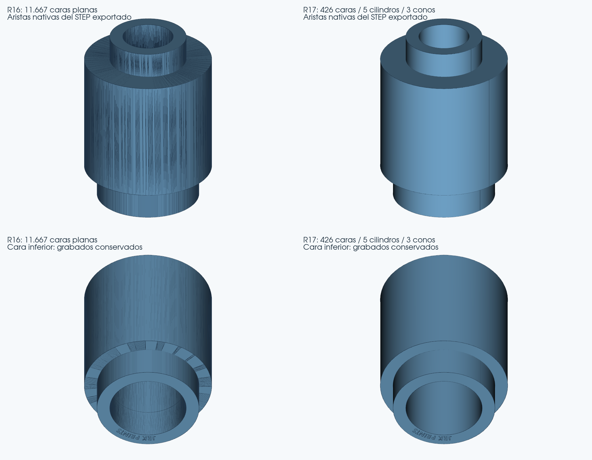

# Visor STL → STEP · R17 experimental · resultados reales

Fecha: 4 de noviembre de 2026. Base: R16, commit `885f4a41a533e028116f5e1ffc1970118cd4b4b4`. Copia experimental independiente para Windows, con las fuentes completas. Se ha dejado la bancada fuera del desarrollo de esta revisión; se comprueba como regresión.

## Resultado conseguido y alcance

**Body mejora de 11.667 planos a 426 caras, con cinco cilindros y tres conos reales.** La mayor parte de las 418 caras planas restantes pertenece a los grabados y sus paredes. Se conservan los nueve rebajes inferiores, de profundidad aproximada 0,253998 mm, y el conducto interior. La mejora está implementada en el motor y se verifica también con Body girada y renombrada y con dos modelos CAD generados independientemente.

El STEP Body pasa de 30,62 MB a 1,76 MB, medidos sobre los archivos reales. La reducción corresponde a la representación geométrica de sus superficies.

**La guía ranurada no está resuelta.** Conserva la salida de R16 de 248 caras planas. No se entrega como mejorada ni se incluye su STEP experimental rechazado.

| Entrada | R16 reproducida | R17 entregada | Desviación máxima observada R17 |
|---|---|---|---:|
| Body.stl | 11.667 planos; 384.837 s por CLI | 426 caras: 5 cilindros, 3 conos y 418 planos; 61.177 s en navegador | 0.005650 mm |
| Lego_Guia circulos .stl | 248 planos; 64.282 s por CLI | 248 planos; 56.524 s en navegador; DATA idéntico a R16 | 0,000000 mm |

Las dos reproducciones R16 de estas entradas se ejecutaron con el perfil Impresión. Body R17 se prueba en el navegador con Precisión y adicionalmente por CLI con Impresión; la guía R17 del navegador usa Impresión. Los perfiles de cada ejecución constan en sus JSON.

Los tiempos son observaciones de esta máquina de dos CPU efectivas, con cargas y recorridos CLI/navegador diferentes. No constituyen un benchmark controlado ni una promesa de tiempo para Windows. La ruta nueva evita en Body varios intentos de reconstrucción fallidos del motor anterior.

El STEP aportado de Body tiene 11.667 caras planas y la misma geometría de referencia que la salida R16 reproducida; el de la guía tiene 248 planos y coincide con el STL aunque su nombre sea distinto. Ambos son sólidos válidos en el análisis nativo. Tener un STEP válido y facetado no implica haber reconstruido sus cilindros.

Esta imagen se genera desde los STEP reales, incluido el archivo descargado desde el Visor; no desde una previsualización STL. La malla de dibujo de una superficie curva no se muestra como aristas CAD. La imagen no sustituye los controles geométricos ni valida Onshape.

## Cambio del motor

Se añade una ruta acotada para cuerpos de revolución con perfiles medibles y rebajes planos en sus extremos. Detecta el eje y contrasta secciones circulares distribuidas, reconstruye el perfil desde el STL y recupera los contornos de los rebajes originales. No depende de nombres de archivo, del tamaño concreto de Body ni de plantillas de esta pieza.

El candidato se construye en un proceso aislado. Antes de aceptarlo se exporta, vuelve a leer, comprueba su B-Rep exacto, interferencias, geometría y material contra el STL original. Fuente, STEP, código, dependencias y perfil quedan vinculados por SHA-256. El control adicional comprueba ambos lados de cada triángulo del fondo de los rebajes. Una propuesta rechazada conserva la entrada y delega en la cadena R16; un cambio de entrada o cancelación interrumpe el trabajo.

La familia no cubre todavía perfiles arbitrarios, todas las ranuras, superficies libres ni todos los STL defectuosos. No se sustituye indiscriminadamente el motor anterior. No se añaden paquetes externos ni se cambia la interfaz, salvo la identificación R17.

## Precisión e integridad de Body descargada

- Desviación máxima observada: **0.005650 mm**; el muestreo denso no es una garantía Hausdorff absoluta.
- Error de caja: **0.001531 mm**. Diferencia de volumen: **0.003705 %**.
- B-Rep exacto válido, un sólido, sin objetos sueltos ni interferencias OCC, sin corregir la topología STEP al exportar. Tolerancia máxima nativa informada por el control CAD: **1e-07 mm**.
- El recuento independiente de entidades del texto STEP confirma **5 `CYLINDRICAL_SURFACE`, 3 `CONICAL_SURFACE`, 418 `PLANE` y un `MANIFOLD_SOLID_BREP`**. La referencia R16 sólo contiene planos. Los hashes y recuentos se incluyen en `TIPOS_STEP_CRUDO_R17.json`.
- Nueve rebajes; **780 comprobaciones dirigidas sobre 390 triángulos de fondo**, cero discrepancias. Profundidad medida conservada.
- **3.000 puntos de material del original**, cero discrepancias, banda excluida de **0,002 mm**, sin ampliar respecto a R16.
- Euler del sólido y de sus mallados: cero; una envolvente. Tres mallados finos cerrados y orientados:

| Deflexión (mm) | Triángulos de verificación | Intersecciones CGAL | Máximo observado del contraste (mm) |
|---:|---:|---:|---:|
| 0.00025 | 53654 | 0 | 0.002694 |
| 0.0005 | 34578 | 0 | 0.002848 |
| 0.001 | 22192 | 0 | 0.003263 |

Estos triángulos pertenecen a las comprobaciones del STEP curvo; el STEP sigue teniendo 426 caras CAD.

Los **16 archivos de validación**, los perfiles y la función `_calidad` conservan sus hashes/AST de R16. Precisión mantiene caja 0,02 mm, P95 0,03 mm, máximo 0,06 mm y volumen 0,5 %. Impresión mantiene caja/P95 0,04 mm, máximo 0,08 mm y volumen 0,5 %. No se han relajado tolerancias para aprobar esta mejora. Body también pasa el perfil Impresión; ambos perfiles producen 426 caras porque este ajuste ya cumple el límite más estricto.

**Copiar las facetas produce error geométrico cero respecto al STL; sustituirlas por cilindros introduce una aproximación medida.** En Body esta aproximación es 0.005650 mm, dentro del perfil Precisión existente. No se afirma que el error sea cero ni que disminuya respecto a la copia facetada de R16. Las conversiones históricas se comprueban por separado para que no cambien.

## Pruebas de la aplicación y regresión

**405 pruebas aprobadas, cuatro omitidas y cero fallos** sobre las fuentes que se entregan, desde una carpeta con espacios. Se ejecuta la batería heredada con las muestras disponibles, incluidos el cubo-carrito y sus giros y la conservación del preprocesamiento de los 14 STL originales. Motivos de las cuatro omisiones:

- `test_muestreo_no_corrompe_juicio_del_brep`: STEP de regresión de caché no indicado.
- `test_no_acepta_cad_solo_por_ser_valido_sin_interferencias`: STEP de regresión densa no indicado.
- `test_rescate_exige_repetir_control_avanzado`: STEP defectuoso aportado no indicado.
- `test_autointerseccion_real_se_rechaza_en_frio_antes_del_mallado`: Fixture CAD externo no disponible.

Se ejecutan **23 conversiones completas por CLI**, con fuente y código identificados por SHA-256 antes y después. Las **19 conversiones de regresión R16** mantienen número y tipos de caras y no empeoran desviación máxima, caja ni volumen. Cuando se indica DATA idéntico, la geometría STEP coincide byte por byte excluyendo la cabecera de fecha:

| Caso histórico | Caras | Máximo observado (mm) | Comparación con R16 | Tiempo R17 (s) |
|---|---:|---:|---|---:|
| 1x1-lego-brick | 2672 | 0.000000 | DATA idéntico | 213.104 |
| Bancada_Motor | 108 | 0.003438 | DATA idéntico | 1574.509 |
| Estefi | 1769 | 0.000000 | DATA idéntico | 465.293 |
| Grapa | 20 | 0.001042 | DATA idéntico | 411.784 |
| LLanta_Trasera | 53 | 0.002138 | DATA idéntico | 92.403 |
| M3 PClip - 2mm | 1484 | 0.000000 | DATA idéntico | 229.837 |
| Spoiler_arrière_Porsche_-_5 | 28 | 0.002827 | DATA idéntico | 7.791 |
| Technic_PEGS_Cross_x6_A | 845 | 0.001192 | DATA idéntico | 1384.002 |
| Tirante | 22 | 0.027430 | DATA idéntico | 893.601 |
| brida_independiente | 10 | 0.000831 | DATA idéntico | 42.658 |
| chasis - Part 2 | 13803 | 0.006785 | DATA idéntico | 624.203 |
| conector | 192 | 0.005906 | Redondeo numérico auditado | 395.460 |
| cubo-carrito | 1152 | 0.000000 | DATA idéntico | 121.724 |
| cubo-carrito_giro_1 | 1838 | 0.000000 | DATA idéntico | 150.072 |
| cubo-carrito_giro_2 | 1195 | 0.000000 | DATA idéntico | 126.880 |
| cubo-carrito_giro_3 | 1853 | 0.000000 | DATA idéntico | 123.686 |
| maneta | 36 | 0.016033 | DATA idéntico | 438.909 |
| pinza | 147 | 0.003787 | DATA idéntico | 445.600 |
| spur | 1405 | 0.004738 | DATA idéntico | 136.211 |

Las filas con redondeo auditado conservan la estructura y todas las referencias STEP. El comparador heredado permite únicamente diferencias de coordenadas cartesianas cercanas a cero de hasta 1e-12 mm; registra cada token cambiado. Esta comparación de serialización no modifica los límites de aceptación geométrica del motor. El JSON de regresión contiene las diferencias reales de cada caso.

Se convierten **13 de las 14 geometrías originales**. `Fast+Funnel+large.stl` sigue aplazada por petición del usuario. El preprocesamiento de los 14 STL no equivale a afirmar 14/14 conversiones completas. El cubo-carrito y los tres giros sí se reparan y convierten completamente.

Los cuatro controles adicionales aplican efectivamente la nueva ruta:

| Control | Perfil | Caras | Máximo observado (mm) | Tiempo (s) |
|---|---|---:|---:|---:|
| Body_girada_anonima | precision | 430 | 0.004747 | 163.885 |
| Body_impresion | impresion | 426 | 0.005650 | 61.411 |
| Independiente_casquillo | precision | 8 | 0.000265 | 23.568 |
| Independiente_rebaje_oblicuo | precision | 9 | 0.000302 | 14.280 |

Body girada se centra, gira 0,47 rad alrededor de (1,2,3), traslada y guarda en STL Float32 bajo un nombre anónimo. No cuenta como pieza independiente. Los otros dos modelos son un casquillo escalonado y un casquillo girado con rebaje, creados desde CAD ajeno a la topología y medidas de Body; sus archivos y parámetros se incluyen como controles sintéticos transparentes, no como modelos descargados de terceros.

Además, se realizan **dos conversiones completas desde Chromium**: carga real, perfil, progreso hasta el 100 %, descarga, coincidencia de bytes con el backend y lectura del STEP. Body: trabajo `d5fff127e10c`, perfil Precisión, 61.177 s. Guía: trabajo `0e610efd55df`, perfil Impresión, 56.524 s. El endpoint oficial de evidencias R17 se descarga para Body y se incluye. La previsualización del Visor continúa mostrando el STL original.

Total: **25 ejecuciones de conversión**, correspondientes a **20 geometrías distintas**; los giros y perfiles repetidos no se cuentan como piezas nuevas. Se ejecutan en Linux, Python 3.12.14, CadQuery 2.8.0, OCP 7.9.3.1.1. Los logs/XML/JSON se incluyen en `Resultados_Pruebas`.

## Intentos descartados en la guía

Se estudiaron perfiles curvos continuos y reconstrucción por estratos. Algunas propuestas formaban un sólido aparentemente válido pero perdían volumen; se rechazaron. La mejor propuesta compacta de 48 caras conservaba aproximadamente el volumen pero falló el control de interferencias con dos problemas BOP. El saneamiento posterior tampoco superó el B-Rep exacto. No se incorporan al motor ni a las muestras entregadas. No se amplía la tolerancia ni la banda de material para hacerlas pasar. La salida final conserva el DATA R16.

## Archivos y uso

El ZIP completo contiene el programa de 337 archivos fuente, sus licencias, lanzadores, informe, entradas Body/guía, sus STEP R17 comprobados y los resultados de las pruebas. No contiene el entorno Python instalado ni un ejecutable compilado. Requiere Python 3.12 de 64 bits y la instalación de dependencias prevista por el Visor, como R7/R16. Descomprimir entero en una carpeta nueva y abrir **Iniciar_R17.bat**. El encabezado debe indicar **R17 experimental**. El ZIP de modificados contiene los diez archivos cambiados o nuevos y sus hashes; para probar se recomienda el completo.

No se modifica R16 ni main. La entrega se publica en `perfeccion_Visualizador_R17`, con ZIP comprobado antes de comunicar el enlace. `FUENTES_SHA256.json` identifica los 337 archivos; `CAMBIOS_R17.json` identifica los diez cambios. Las evidencias corresponden al mismo código Python que el paquete.

## Comprobaciones pendientes

- Ejecución en **Windows nativo**, con instalación limpia y con el equipo del usuario.
- Importación de estos STEP en **Onshape**; las pruebas nativas de OpenCascade/CGAL no sustituyen esa importación.
- Prueba física en **Creality K1C**; el ajuste de altura de capa no demuestra por sí mismo la exactitud dimensional de impresión.
- Resolución de la **guía ranurada**. Se conserva una salida facetada válida, sin presentarla como mejora.
- Conversión del embudo aplazado y generalización a familias fuera del alcance descrito.

La bancada se conserva mediante regresión; no se presenta esta revisión como un avance nuevo de esa pieza.
