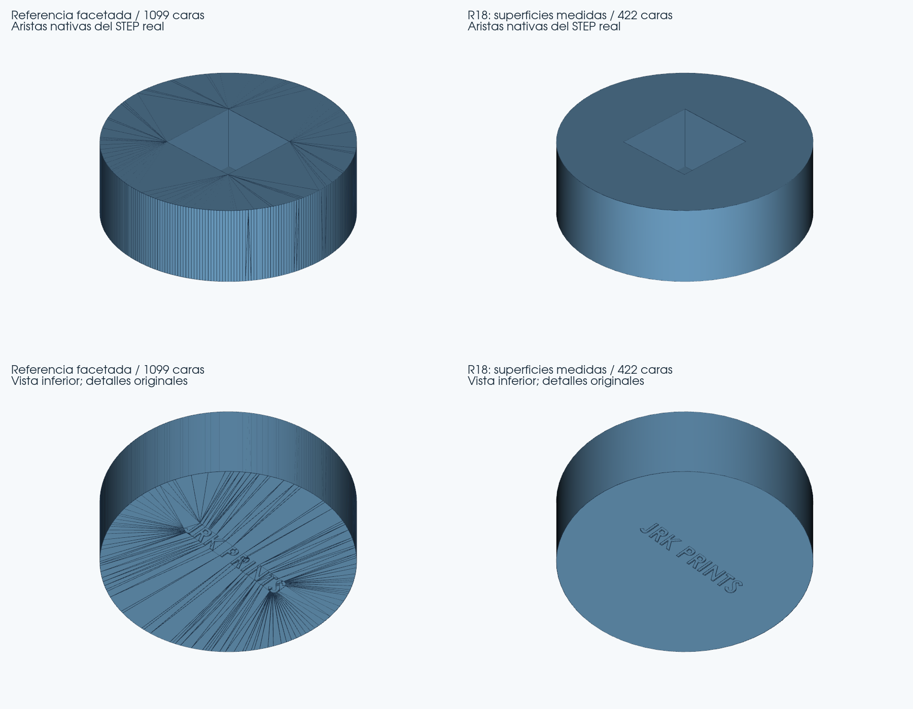
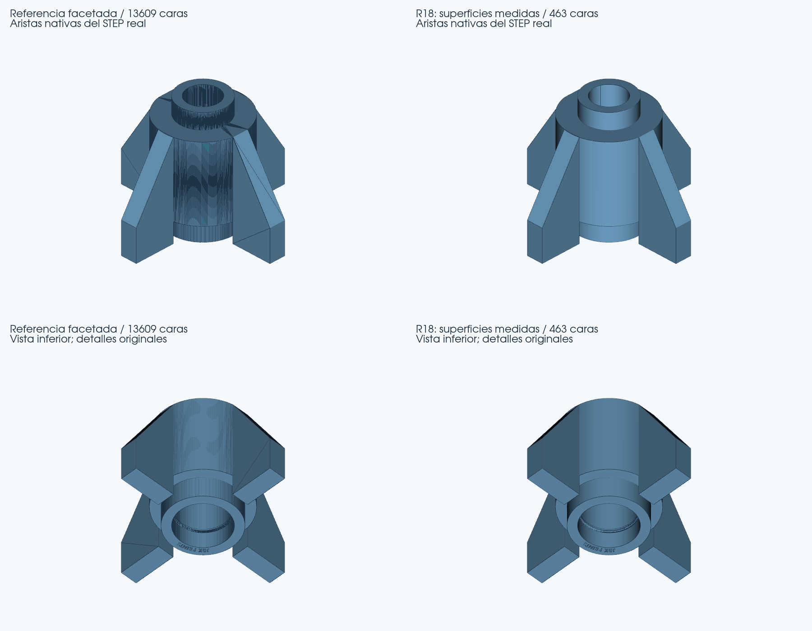

# Visor STL → STEP · R18 experimental · resultados reales

5 de noviembre de 2026, fecha de Madrid. Copia independiente del Visor completo para Windows, basada en R17 (`c5175a170aab82ecac7acae4cb5761682de62f35`). Se conservan R17 y main. La bancada permanece como control de regresión.

## Mejoras comprobadas

**Flame y Base pasan de superficies facetadas a cilindros reales, conservando sus detalles. Body mantiene exactamente la geometría del STEP que aportó el usuario.**

| Pieza | Referencia | R18 descargada desde el Visor | Máximo observado |
|---|---|---|---:|
| Flame_Base | 1.099 caras planas del STEP previo aportado | 422 caras: 421 planos y un cilindro; 37.513 s | 0.001484 mm |
| Base | 13.609 caras planas, ejecutando R17 sobre el STL original | 463 caras: 445 planos, ocho cilindros y diez conos; 45.962 s | 0.005532 mm |
| Body | 426 caras del STEP aportado | 426 caras, DATA idéntico al archivo del usuario; 32.193 s | 0.005650 mm |

La referencia facetada reproduce las facetas del STL; sustituirlas por curvas introduce la pequeña aproximación medida en la tabla. Las mediciones respaldan esa aproximación, sin afirmar error geométrico cero.

Los planos restantes incluyen paredes de grabados y superficies planas de los refuerzos. El recuento no se presenta como eliminación de todas las aristas ni como modelo paramétrico editable por operaciones. Los cilindros y conos son superficies CAD analíticas, no triángulos renombrados.

Flame conserva el vaciado cuadrado profundo y los nueve grabados inferiores: diez rebajes comprobados. Base conserva los cuatro refuerzos, el conducto interior, sus transiciones y los vaciados abiertos y cubiertos junto a los refuerzos. Los fondos de esos vaciados y los planos originales se contrastan a ambos lados de los triángulos fuente; las tapas finas no se rellenan por conveniencia.

Las imágenes se generan desde los STEP reales, incluidos los descargados del Visor; no muestran las aristas de su teselación de dibujo. La previsualización del Visor continúa mostrando el STL original: para apreciar la reconstrucción se abre el STEP descargado en CAD.

El STEP Base previo aportado superaba el límite de transferencia de 32 MiB y no se ha leído. Su referencia se ha obtenido ejecutando R17 sobre el STL ahora disponible: 13.609 planos, sólido válido, 968.809 segundos según el registro. No se afirma identidad de bytes con aquel STEP inaccesible. Los tiempos de esta máquina Linux, con dos CPU efectivas y cargas distintas, son observaciones; no constituyen una comparativa controlada ni una promesa de velocidad para Windows.

## Motor y alcance de la familia

Se añaden núcleos de revolución macizos o anulares con cavidades prismáticas profundas y refuerzos planos radiales. Esta ruta exige una malla cerrada y orientada; las reparaciones de STL defectuosos permanecen en la cadena existente. El motor mide el eje en los planos de las tapas, contrasta secciones circulares y reconstruye los perfiles desde el original. Conserva los contornos de los detalles, en vez de sustituir toda la pieza por un cilindro ideal.

Hay dos construcciones acotadas: un marco axial centrado para estabilizar encuentros y un orden de cortes anterior a las uniones con calibración circular apoyada en vértices originales. Cada candidato se exporta, relee y verifica por completo; que un orden falle no acredita al siguiente. La selección depende de la geometría y los controles, sin nombres de archivo ni plantillas dimensionales de estas piezas. Body continúa por R17. Los casos fuera del alcance conservan la cadena anterior; cambios de entrada o cancelación interrumpen el trabajo.

La construcción normaliza coincidencias de planos dentro de 0,0001 mm y utiliza resolución numérica de unión de 0,0001 mm; algunos cortes resuelven empates a 0,000005/0,00001 mm. Son parámetros para proponer una frontera consistente, **no nuevos límites para aceptar geometría**. La simplificación meridiana está acotada a 0,00008 mm y la evidencia de ajuste circular a 0,004 mm; ninguna sustituye los controles finales contra el STL original.

No es una solución para todos los cilindros, superficies libres, ranuras ni STL defectuosos. La guía ranurada se conserva facetada; se comprueba sin atribuirle una mejora. Algunos candidatos previos de Base parecían sólidos válidos pero tenían caras diminutas sin mallar, bordes abiertos o interferencias: se descartaron. Los resultados iniciales de dos casquillos independientes obligaron a mejorar la calibración antes de repetir la matriz definitiva; no se cuentan esos intentos como éxitos de la entrega.

## Precisión, material e integridad

Los perfiles y **16 archivos de validación conservan sus hashes R17**, y `_calidad` conserva su AST. La banda excluida del contraste de material sigue siendo **0,002 mm**. Precisión mantiene máximo 0,06 mm y caja 0,02 mm, con P95 existente según el caso; Impresión mantiene máximo 0,08 mm y caja/P95 0,04 mm. Los límites exactos de cada conversión constan en sus JSON. No se han ampliado para aprobar R18.

Flame: error de caja 0.000349 mm y volumen 0.007725 %. Base: caja 0.000031 mm y volumen 0.001607 %. Las desviaciones son mediciones muestreadas, no una garantía Hausdorff absoluta de todos los puntos.

Ambas pasan B-Rep exacto, interferencias nativas, un único sólido sin objetos sueltos, cierre y orientación. Cada una contrasta 3.000 puntos de material contra el original, con cero discrepancias. Base añade 868 comprobaciones dirigidas en fondos y 72 en planos de refuerzos. Los registros oficiales completos están vinculados por SHA-256 a fuente, STEP, código, dependencias, perfil y petición.

| STEP descargado | Deflexión (mm) | Triángulos de verificación | Euler | Cruces CGAL | Máximo del contraste (mm) |
|---|---:|---:|---:|---:|---:|
| flame | 0.00025 | 5500 | 2 | 0 | 0.001480 |
| flame | 0.0005 | 4364 | 2 | 0 | 0.001484 |
| flame | 0.001 | 3560 | 2 | 0 | 0.001480 |
| base | 0.00025 | 84050 | 0 | 0 | 0.002438 |
| base | 0.0005 | 51430 | 0 | 0 | 0.002626 |
| base | 0.001 | 32224 | 0 | 0 | 0.003046 |

Esos triángulos pertenecen a las pruebas; no son las caras del STEP curvo entregado. Los dos perfiles producen DATA STEP idéntico en Flame y Base porque el mismo ajuste ya cumple Precisión; elegir 0,08 mm no obliga a generar otra geometría.

## Pruebas reales de esta entrega

**423 pruebas aprobadas, cuatro omitidas y cero fallos** sobre las fuentes entregadas. La batería incluye conservación de los 14 STL originales sanos en preprocesamiento, reparaciones y rechazos. Omisiones identificadas:

- `test_muestreo_no_corrompe_juicio_del_brep`: STEP de regresión de caché no indicado.
- `test_no_acepta_cad_solo_por_ser_valido_sin_interferencias`: STEP de regresión densa no indicado.
- `test_rescate_exige_repetir_control_avanzado`: STEP defectuoso aportado no indicado.
- `test_autointerseccion_real_se_rechaza_en_frio_antes_del_mallado`: Fixture CAD externo no disponible.

**33 conversiones completas por CLI y tres por la interfaz Chromium: 36 ejecuciones.** Código y originales se comprueban por hash antes y después. Las 25 regresiones mantienen número y tipos de caras y no empeoran máximo, caja ni volumen frente a R17. DATA idéntico significa coincidencia byte a byte desde `DATA;`; cuando se indica redondeo, se adjunta la auditoría heredada de tokens y referencias, limitada a coordenadas cercanas a cero hasta 1e-12 mm.

| Regresión | Caras | Máximo (mm) | Geometría frente a R17 | Tiempo (s) |
|---|---:|---:|---|---:|
| 1x1-lego-brick | 2672 | 0.000000 | DATA idéntico | 180.328 |
| Bancada_Motor | 108 | 0.003438 | DATA idéntico | 1081.349 |
| Body_girada_anonima | 430 | 0.004747 | DATA idéntico | 48.129 |
| Body_impresion | 426 | 0.005650 | DATA idéntico | 48.700 |
| Body_usuario | 426 | 0.005650 | DATA idéntico | 48.889 |
| Estefi | 1769 | 0.000000 | DATA idéntico | 411.142 |
| Grapa | 20 | 0.001042 | DATA idéntico | 341.225 |
| Guia_ranurada | 248 | 0.000000 | DATA idéntico | 40.191 |
| Independiente_casquillo | 8 | 0.000265 | DATA idéntico | 9.921 |
| Independiente_rebaje_oblicuo | 9 | 0.000302 | DATA idéntico | 8.764 |
| LLanta_Trasera | 53 | 0.002138 | DATA idéntico | 52.346 |
| M3 PClip - 2mm | 1484 | 0.000000 | DATA idéntico | 265.213 |
| Spoiler_arrière_Porsche_-_5 | 28 | 0.002827 | DATA idéntico | 5.300 |
| Technic_PEGS_Cross_x6_A | 845 | 0.001192 | DATA idéntico | 1221.134 |
| Tirante | 22 | 0.027430 | DATA idéntico | 636.012 |
| brida_independiente | 10 | 0.000831 | DATA idéntico | 22.878 |
| chasis - Part 2 | 13803 | 0.006785 | DATA idéntico | 448.457 |
| conector | 192 | 0.005906 | Redondeo auditado | 238.998 |
| cubo-carrito | 1152 | 0.000000 | DATA idéntico | 99.876 |
| cubo-carrito_giro_1 | 1838 | 0.000000 | DATA idéntico | 97.224 |
| cubo-carrito_giro_2 | 1195 | 0.000000 | DATA idéntico | 66.707 |
| cubo-carrito_giro_3 | 1853 | 0.000000 | DATA idéntico | 100.920 |
| maneta | 36 | 0.016033 | DATA idéntico | 341.728 |
| pinza | 147 | 0.003787 | DATA idéntico | 250.921 |
| spur | 1405 | 0.004738 | DATA idéntico | 111.183 |

Se reparan y convierten el cubo-carrito y sus tres giros. Se convierten **13 de las 14 geometrías originales**; el embudo sigue aplazado por petición del usuario. Haber comprobado preprocesamiento de 14 no equivale a afirmar 14/14 conversiones.

Los ocho controles siguientes aplican efectivamente la ruta R18, incluidos modelos CAD independientes con distintas medidas y un caso oblicuo:

| Control | Perfil | Caras | Máximo (mm) | Tiempo (s) |
|---|---|---:|---:|---:|
| Flame_Base | precision | 422 | 0.001484 | 34.525 |
| Base | precision | 463 | 0.005532 | 65.841 |
| Flame_impresion | impresion | 422 | 0.001484 | 48.636 |
| Base_impresion | impresion | 463 | 0.005532 | 56.417 |
| disco_macizo | precision | 3 | 0.000258 | 7.467 |
| cilindro_vaciado_profundo_oblicuo | precision | 13 | 0.000336 | 9.662 |
| casquillo_refuerzos_2_oblicuo | precision | 17 | 0.000406 | 18.427 |
| casquillo_refuerzos_4 | precision | 31 | 0.000347 | 14.439 |

Los cuatro controles independientes son modelos sintéticos transparentes: disco macizo; cilindro girado con cavidad profunda y rebaje inferior; casquillo girado con dos refuerzos; casquillo con cuatro refuerzos. Incluyen encuentros abiertos y cubiertos. Sus STL, STEP CAD de referencia y parámetros están en `Controles_Independientes`; no son modelos descargados de terceros ni piezas del usuario contadas dos veces por cambiarles el nombre.

Las tres pruebas de interfaz verifican carga, perfil Precisión predeterminado, progreso al 100 %, descarga idéntica al backend, registro oficial y STEP reabierto. Los archivos incluidos como referencias R18 son exactamente los descargados. Body conserva además el DATA del STEP aportado. Windows nativo y Onshape no quedan validados por esta prueba Linux.

## Archivos y reproducción

El ZIP completo contiene 342 archivos fuente, licencias, lanzadores, informe, comparaciones y evidencias. El ZIP de modificados contiene los 13 archivos nuevos o cambiados y sus hashes. Para probar se recomienda el completo en una carpeta nueva: abrir **Iniciar_R18.bat** y comprobar **R18 experimental**. Requiere Python 3.12 de 64 bits y el entorno CAD del Visor, como R7/R17; no incluye un ejecutable compilado ni un entorno instalado. La interfaz y sus perfiles se conservan.

`Herramientas_Pruebas/reproducir_nuevos_controles.py`, ejecutado con el Python CAD, repite las siete geometrías de muestra incluidas. `Resultados_Pruebas` contiene XML, registros, matrices, hashes y protocolos de las pruebas de desarrollo; la batería histórica requiere las muestras externas indicadas en esos protocolos y variables de entorno. No se incluyen todos los STEP históricos voluminosos en el ZIP: su comparación y hashes quedan registrados. `FUENTES_SHA256.json` identifica exactamente las fuentes; `CAMBIOS_R18.json`, los 13 cambios.

## Comprobaciones pendientes

- Windows nativo, instalación limpia y equipo del usuario.
- Importación de estos STEP en Onshape.
- Impresión física y medidas en Creality K1C.
- Familias fuera del alcance, mejora de la guía y el embudo aplazado.

La bancada conserva la salida R17 mediante regresión; no se presenta como mejorada en R18. No se promete reconstrucción perfecta de STL arbitrarios.
