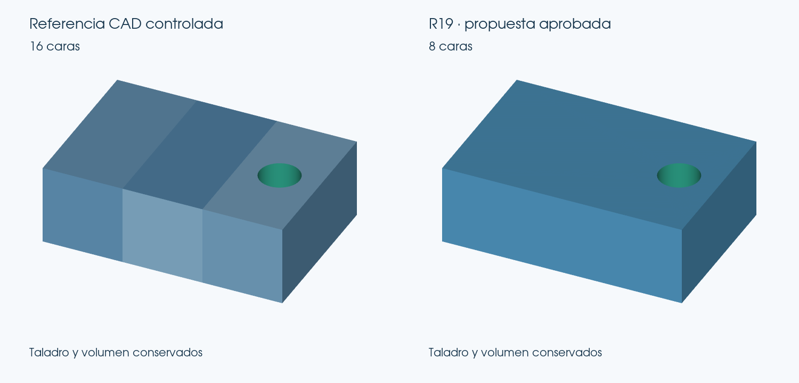

# R19 experimental: resultado de la entrega

El Visor completo ejecuta ahora un pipeline modular con ingesta OCP, reconstrucción analítica R18, propuestas planas y cilíndricas, costura estricta, STEP AP214 reimportado y controles fríos. Conserva la interfaz y los perfiles. Se entrega en carpeta independiente y puerto 8782; R18 conserva su puerto 8781.

## Conversión real desde STL

La API asíncrona de esta R19 convirtió Bancada_Motor desde su STL y seleccionó **101 caras frente a 108**, un 6,48 % menos. Conservó el máximo verificado **0,003438 mm**, B-Rep exacto, cierre y topología. Los tres mallados tienen cero autointersecciones CGAL; 2998 muestras de material, cero discrepancias. El contraste de 17987 puntos comunes no detecta aumentos superiores a 0,0001 mm.

SHA256 STEP seleccionado: `a54f6b442f70469d991e78f3d6e93947a41e16407437ad806fe81dec250f4099`.

Tiempo observado: 786.6 s en Linux con otros ensayos concurrentes. No se afirma una mejora de velocidad.

## Ensayos independientes del módulo de optimización

Estos ensayos parten de referencias CAD existentes: **no son ocho conversiones completas nuevas**. Los tres primeros son controles CAD sintéticos construidos y validados, no resultados del conversor R18 sobre esos STL. En planos_y_taladro se conservan las dos caras cilíndricas protegidas.

| Caso | Caras | Máximo verificado mm | Origen |
| --- | --- | --- | --- |
| caja_fragmentada | 12 → 6 | 0.0 | Control CAD sintético |
| planos_y_taladro | 16 → 8 | 2.5e-05 | Control CAD sintético |
| placa_seis_taladros | 18 → 12 | 6.2e-05 | Control CAD sintético |
| Base | 463 → 463 | 0.005532 | Postproceso referencia R18 conservada |
| Body | 426 → 426 | 0.00565 | Postproceso referencia R18 conservada |
| Flame_Base | 422 → 422 | 0.001484 | Postproceso referencia R18 conservada |
| Lego_Guia circulos | 248 → 248 | 0.0 | Postproceso referencia R18 conservada |
| maneta | 36 → 36 | 0.016033 | Postproceso referencia R18 conservada |

Los cinco casos reales sin mejora conservan exactamente sus referencias. La propuesta de maneta de 34 caras se rechaza por reducción insuficiente y se mantienen 36. El candidato periódico antiguo de 99 caras supera los controles generales originales, pero R19 lo rechaza porque empeora el máximo frente a la referencia; ese rechazo no se cuenta como mejora geométrica.

El control CAD de seis taladros transformado rígidamente (giro y traslación) también pasa de 18 a 12 caras, máximo verificado 0,000065 mm y sin regresiones locales superiores a 0,0001 mm. Es una transformación de una referencia sintética, no una conversión R18 nueva.

## Pruebas y conservación

**438 pruebas aprobadas, 4 omitidas, cero fallos y cero errores** en la batería completa de esta R19. No se suman repeticiones de subconjuntos ni las siete pruebas del antiguo proponente RANSAC, que no forman parte de este pipeline. Las omisiones corresponden a fixtures CAD externos ausentes y se enumeran en RESULTADOS.json.

Chromium verificó importación, cambio de perfil, conversión real por HTTP y descarga STEP, sin errores JavaScript. El STEP descargado se reimporta y conserva un sólido válido. Es una prueba del Visor local con backend Python; no se atribuye al conversor web estático separado.

Los 342 hashes de R18 se conservan tanto en la referencia publicada como en la copia congelada del prototipo. El núcleo geométrico, los validadores, perfiles y tolerancias originales no se modifican. CAMBIOS_R19.json diferencia los módulos nuevos de los ajustes de servidor, identidad, entorno y tests de integración.

## Uso y límites

Extraer en carpeta nueva y ejecutar **Iniciar_R19.bat**. Se reutiliza el entorno CAD existente sin modificarlo, o se instala uno independiente con el instalador suministrado. Las 357 fuentes se extrajeron también en una carpeta independiente: la CLI convirtió una caja y el control de planos y taladro volvió a seleccionar 16 → 8 caras con control frío. El ZIP final conserva los mismos hashes.

El paquete contiene las fuentes completas y lanzadores, igual que R18; las dependencias no se incrustan como un ejecutable Windows.

La reconstrucción de cilindros parciales conserva las capacidades existentes de R18. Los prototipos rechazados de recorte UV no se activan. Las nuevas optimizaciones se limitan a sólidos y dominios soportados; las demás conversiones conservan su ruta anterior.

**Windows nativo y las importaciones en Onshape, SolidWorks e Inventor están pendientes.** STEP AP214 válido y reimportado en OCP no se presenta como compatibilidad total ya demostrada. No se incluyen los modelos privados nuevos del usuario.
