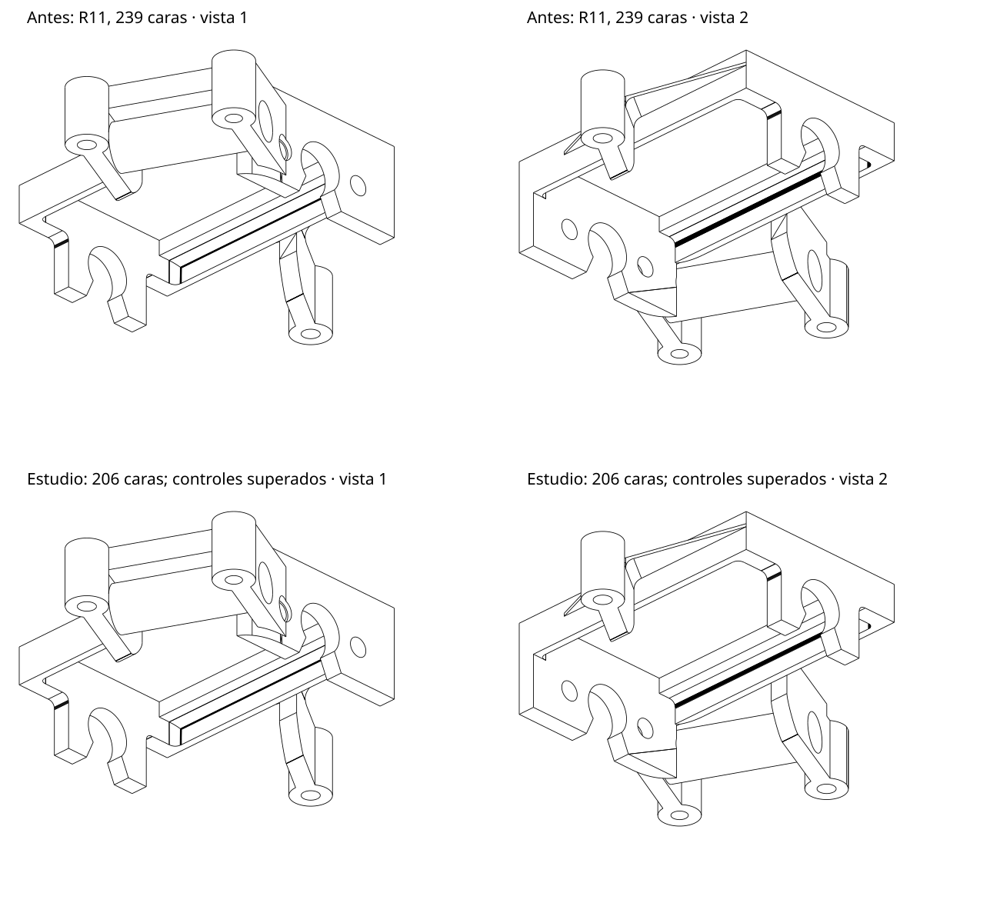

# Investigación posterior a R11 · resultados reales · 29/10/2026

**Entrega parcial de desarrollo. No se publica R12 y no se actualiza el Visor R11.**

Se implementan cambios genéricos sobre copias experimentales. La reconstrucción general M34 sigue sin aprobarse para las piezas objetivo. Una segunda herramienta, que reúne parches de un STEP ya válido conservando sus fronteras, sí ha mejorado la bancada y ha pasado toda la validación. El usuario puede comparar ese STEP sin instalar nada.

## Resultado utilizable para comparar: bancada

`STEP_VALIDADO/Bancada_ESTUDIO_206caras.step` se genera desde el STEP de R11 y se contrasta contra el STL original incluido. No hay reglas por nombre de pieza ni retoques manuales del archivo. Se reúnen regiones compatibles y se conservan todas las curvas exteriores; los dominios con varios contornos se mantienen cuando no hay una unión certificada.

| Medida | R11 del usuario | Estudio validado |
|---|---:|---:|
| Caras totales | 239 | 206 |
| Caras B-spline | 50 | 29 |
| Cilindros | 25 | 25 |
| Superficies de extrusión | 14 | 14 |
| Sólidos | 1 | 1 |
| Área cilíndrica, mm² | 1047,309292389 | 1047,309292389 |

Se eliminan 33 caras (13,8 %); quedan parches y líneas interiores. **No se declara recuperada la calidad completa ni resuelto el defecto visual que observa el usuario en todas sus zonas.** La imagen de aristas adjunta permite comparar dos vistas.

 La observación en Onshape sigue pendiente.

La lectura del STEP exportado pasa B-Rep exacto, coherencia UV/3D, comprobación de interferencias en frío y ausencia de objetos sueltos. Los 25 cilindros completos conservan radio, eje, posición y área, contrastados con una cota de 1e-8; además se comprueban los cilindros respaldados por el STL sobre sus recortes reales. Tolerancia máxima de arista: 1e-07 mm. Euler original y STEP: -14.

| Fidelidad contra el STL original | Resultado | Límite conservado |
|---|---:|---:|
| Error de caja, mm | 0.000561 | 0.02 |
| Error de volumen, % | 0.026516 | 0.5 |
| p95 denso CAD→STL, mm | 0.000794 | 0.02 |
| Máximo denso CAD→STL observado, mm | 0.003965 | 0.06 |

Son muestreos deterministas, no una garantía de Hausdorff global. La validación no ha utilizado el perfil de impresión de 0,08 mm.

Los tres mallados finos del STEP también deben pasar cierre, orientación, Euler, ausencia de contactos ambiguos e intersecciones CGAL, y fidelidad superficial:

| Deflexión, mm | Triángulos | Cerrado y orientado | Cruces CGAL | Máximo observado, mm |
|---:|---:|---|---:|---:|
| 0.00025 | 336080 | Sí | 0 | 0.003436 |
| 0.00050 | 175718 | Sí | 0 | 0.003437 |
| 0.00100 | 96898 | Sí | 0 | 0.003436 |

SHA-256 del STEP entregado: `e9f27b82038c26586711053dc377b2579724bad15885e78a2af1945e32ba64f2`. Fuente STL: `1b0dac5808f07b68a1ec91b8baa83d11a56c20dd0d83611c02e0a0bc12b2a0c1`. STEP base: `9dff883b5e24fda10160c2711d3915097bdafa349ad3ad7d7f7d4bed8f82f0fb`. El reproducer incluido ha generado y validado este archivo desde la copia de fuentes preparada para entregar; las entradas permanecen intactas.

## Implementaciones en la copia del motor

- Proyección global de perfiles cúbicos por tramos Bézier. En una esquina real de la bancada se corrige un falso alejamiento de 0,019409 mm: la distancia correcta es 0,000002596 mm, comprobada con una búsqueda independiente.
- Medición de perfiles extruidos, campos suaves y esferas respaldados por el STL; control del interior de facetas para evitar convertir polígonos en cilindros por coincidencia de sus vértices.
- Anclajes conjuntos de perfiles con cota explícita de 0,003 mm en sus polos y objetivos compartidos por vértice. Se preservan los límites de fuente y UV/3D.
- Curvas de intersección compartidas, segmentos paramétricos cortos normalizados y composición exacta cuando es posible. Se retiran hipótesis locales incompatibles para intentar una transición libre.
- Herramienta adicional de reunión CAD con controles sobre la frontera y comparación bidireccional del soporte finito antes de proponer la sustitución. No está integrada en la aplicación publicada.

Dentro del motor hay 11 archivos modificados y 17 nuevos respecto de R11; se incluyen fuentes completas y un parche de texto. Los lanzadores y metadatos R11 que se conservan en esas fuentes son herencia de la referencia: **el motor de investigación no está aprobado como programa para uso**.

## Pruebas ejecutadas

- **284 pruebas superadas, 0 omitidas** en la batería completa M34; tres advertencias de dependencias. Incluye las nuevas regresiones de proyección real y retirada de hipótesis.
- **3 pruebas superadas** de la herramienta CAD: reunión de una cara dividida sin cambiar área/volumen/cierre; conservación de esquinas; rechazo de una extensión fuera del soporte finito.
- Sobre las fuentes preparadas para entregar: **54 pruebas del motor y 3 de CAD superadas**. Son subconjuntos y repetición de las anteriores; no se suman como casos nuevos.
- Reproducción completa de la bancada desde las herramientas y fuentes entregadas: propuesta, exportación y toda la validación aprobadas. El STEP incluido es el de esa ejecución.
- Control sintético ondulado: referencia facetada artificial de 132 caras → 6 caras, con cinco planos y una extrusión curva. Pasa CAD/material/tres mallados finos. No es una pieza del usuario ni demuestra por sí solo una mejora de piezas reales.

## Resultados no aprobados y límites

| Objetivo | Resultado real |
|---|---|
| Bancada, reconstrucción general M34 | Agotó 600 s; no produjo un STEP aprobado. La reunión CAD posterior sí produce la bancada de 206 caras anterior. |
| Technic | La reconstrucción M34 se rechaza porque una subdivisión abandona la arista fuente acotada; unos 508 s. El STEP aportado tiene 2044 caras planas y es válido localmente; eso no explica ni resuelve el fallo de importación en Onshape. |
| Soporte Muelle | El STL está cerrado y orientado; el STEP aportado tiene 19563 caras planas. La nueva ruta agota 600 s y no produce una mejora aprobada. Una hipótesis compacta antigua de 195 caras falla B-Rep exacto y registra 234 defectos BOP: se descarta. |
| Conector | No hay nuevo resultado aprobado. El STEP adjunto exacto excedía el límite de descarga; el STL disponible tiene 140342 triángulos y queda fuera del presupuesto de esta ruta. |
| Maneta y resto de piezas | No se ejecuta una nueva comparación visual completa ni una nueva batería de conversiones de las 14 piezas con esta copia. No se atribuyen a este trabajo los resultados anteriores de R11. |

Una propuesta de bancada con 203 caras era CAD válida, pero se separaba del STL hasta unos 0,40152 mm. El control completo la rechazó; **no se entrega ese STEP**. De este rechazo surge el control bidireccional temprano del soporte. Otra propuesta de 207 caras también pasó el control completo, pero se entrega sólo la de 206 para una comparación clara.

La bancada histórica de 89 caras falla CAD exacto y tiene cuatro defectos BOP. No se restaura por su menor número de caras.

No se ha vuelto a demostrar 14/14 conversiones originales ni el cubo-carrito con una nueva aplicación integrada. Eso es obligatorio antes de publicar una actualización. El embudo continúa aplazado por indicación del usuario. Windows nativo, Onshape e impresión K1C no se han ejecutado aquí. No se promete una aceleración general.

## Conservación y siguiente trabajo

Los 150 archivos del motor R11 congelado conservan sus SHA-256. La entrega R11 de referencia corresponde al commit `9b696ce477e1cd5de970dacf4e96c3b129aa150a`. No hemos modificado la rama de uso `perfeccion_Visualizador` ni su paquete; esta entrega añade investigación en una rama separada, sin sustituir ese programa.

El siguiente trabajo técnico es construir regiones suaves alrededor de agujeros y contornos múltiples sin fragmentar sus interiores, resolver las transiciones de Technic dentro de la cota fuente y descomponer el soporte de muelle conservando sus superficies de revolución. La reunión CAD validada será una ruta adicional con retorno al resultado anterior si falla cualquier control. Sólo después de validar los objetivos reales y repetir las conversiones originales se integrará en una nueva versión.

## Reproducir la batería completa

En `fuentes_investigacion_M34`, con los materiales de auditoría R11 extraídos, establecer `VISOR_MATERIAL_PRUEBAS` a la carpeta `material_pruebas`, `VISOR_CASOS_R2` a `casos_usuario_r2` y análogamente R3/R4/R5, `VISOR_RESULTADOS_R5` a `fixtures_reparador_r5`, y las siguientes rutas relativas al material:

- `VISOR_FIXTURE_CACHE_R2`: `regresiones_cad_no_aceptados/4600_fixed.step`.
- `VISOR_FIXTURE_DENSO_R2`: `regresiones_cad_no_aceptados/Pieza ambigua.step`.
- `VISOR_FIXTURE_RESCATE_R3`: `regresiones_cad_no_aceptados/Con fallos pero si step.step`.
- `VISOR_BATERIA_EXTERNA`: la carpeta hermana `banco_negativo_R7` de la auditoría R11.

Ejecutar `python -m pytest -q`. Es importante usar esas referencias negativas de la auditoría y no un archivo homónimo ya corregido. Los informes anteriores conservan rutas del entorno de ejecución como procedencia; las herramientas de reproducción de esta entrega usan rutas relativas.
